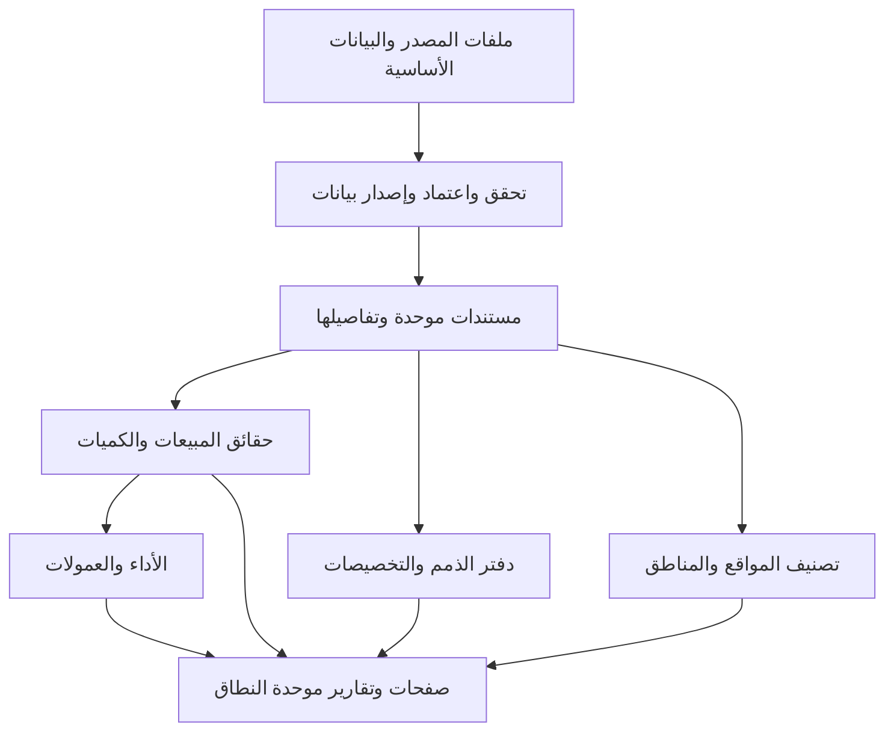

# مراجعة دمج الأنظمة الثلاثة

> منقول من `docs/INTEGRATION-REVIEW.md`.
> **وثيقة مرجعية:** تحليل وسجل تاريخي. القواعد السارية في [المرجع](../10-spec/README.md) و[فهرس القرارات](../40-decisions/INDEX.md).

**الحالة الحالية 0.1.63 — 7/10/2026:** هذا الملف سجل تاريخي للتحليل والاستنتاجات، وليس قائمة قرارات مفتوحة سارية. حُسمت الحزمة في [القرارات الـ94](../40-decisions/B001-B094.md)، وحُدّثت حالات OPEN في MASTER-SPEC. نصوص المقترحات القديمة لا تتقدم على الاعتماد الأحدث. [تجربة الاستخدام الحالية](../20-ux/README.md) للمراجعة قبل البناء.

تاريخ التحليل: 2026-09-29؛ تحديث الاتفاقات وفحص المصادر: 2026-10-04، Asia/Amman. الحالة: تحليل ومقترحات للمراجعة، لا تنفيذ ولا اعتماد تلقائي للقواعد القديمة.

**توضيح نطاق البيانات — DATA-008:** جميع ملفات البيانات التي قدمها المستخدم حتى الآن أمثلة للتخطيط والاختبار، ويشترط صحتها واتساقها. المعتمد هو هيكلها ومعانيها والقواعد المتفق عليها. لا تستخدم سجلاتها أو مجاميعها كبيانات تشغيل فعلية؛ تُرفع الملفات الحقيقية بعد اكتمال التطوير. يبقى فحص العينات دليلًا على النتائج المحددة التي اختبرت فيها، وتصحح أخطاؤها بدل تجاهلها.

## 1. النتيجة

التصميم المقترح هو تطبيق واحد بقاعدة Supabase/PostgreSQL واحدة، وتعريفات ومستندات مشتركة، ومنطق متخصص للحسابات والأداء والجغرافيا. تستخدم الصفحات هذه النتائج بدل نسخ المعادلات والبيانات في كل وحدة. لا نحتاج ثلاثة تطبيقات خلف قائمة واحدة، ولا خدمات مصغرة لكل صفحة.

يمكن التخطيط لمئات الآلاف من الصفوف بهذا البناء، لكن إثبات سرعة محددة يحتاج اختبارًا على حجم ممثل وموارد تشغيل معلومة. لم تُشغّل اختبارات حمل ولم تُعدّل قاعدة بيانات في هذه المراجعة.

ترتيب الحجية: توجيه محمد الصريح الأحدث في هذه الجلسة، ثم [مرجع الاتفاقات](../10-spec/README.md)، ثم شرح النظام السابق والكود بوصفهما مصادر للاستفادة. النقل من النظام السابق لا يحول قاعدة تجارية إلى اتفاق جديد.

## 2. المصادر وحدود التحقق

تمت قراءة الملفات الثلاثة كاملة، بإجمالي 3,437 سطرًا:

| المصدر | الملف الأصلي | النسخة المرجعية | ما يغطيه |
| --- | --- | --- | --- |
| L | نص ملصق.txt، 1,002 سطر | [شرح الخرائط](../80-sources/legacy-maps.txt) | الصفحات، المناطق، الإحداثيات، اليوم التشغيلي، أخطاء التطوير |
| A | نص Markdown ملصق (2).md، 843 سطرًا | [شرح الحسابات](../80-sources/legacy-accounts.md) | المستندات، Ledger، FIFO، الذمم، الكشوف، التقارير والأخطاء |
| T | نص Markdown ملصق (3).md، 1,592 سطرًا | [شرح TARGET](../80-sources/legacy-target.md) | القواعد، المكافآت، التقويم، أهداف وبطاقات المندوب والمشرف |
| M | مرجع الاتفاقات عند التحليل 0.1.17؛ تحديث القرارات حتى 0.1.62 | [MASTER-SPEC](../10-spec/README.md) | القرارات الحالية وفحص الملفات الأساسية ونسختي الفواتير والمرتجعات المحدثتين |
| U | تفصيل المستخدم لكشف الحساب من 29 نقطة، ثم طلب إلغاء الوقت، بتاريخ 2026-09-30 | STMT-001 إلى STMT-008 في [MASTER-SPEC](../10-spec/README.md) | متطلبات للصفحة الجديدة، لا تقرير فحص لتطبيق ماستر |

الإحالات مثل T «قاعدة إجمالي المبيعات» تشير إلى عنوان داخل المصدر. تكرار الفكرة في المصدر لا يعني ميزة جديدة.

فُحصت مواضع محددة من الأرشيفات السابقة الموجودة في مساحة العمل، دون تشغيل الأنظمة:

- الخرائط: `server.ts`، الدالة `getOperationalFields`، واختبارات `isDefined/isActive` في مسارات الاستيراد؛ و`src/utils/coordinateNormalizer.ts`، أولوية الإحداثيات المعتمدة.
- الحسابات: `serverFinanceEngine.ts`، تصنيف المرتجعات حسب الرصيد السابق والعائلة؛ ومواضع القراءة/الكتابة إلى Ledger وFIFO في `serverStatements.ts` و`serverReceivables.ts`.
- TARGET: `src/services/commissionEngine.ts`، فرع قراءة الكشف المقفل؛ و`employeeEmploymentWindow.ts` و`calendarService.ts`؛ وحاسبة العملاء المؤهلين ومحلل إعدادها.

هذه شواهد محدودة على نقاط مؤثرة، وليست تصديقًا بأن الأرشيف يطابق كل سلوك في آخر نسخة منشورة. الشرح الجديد قد يصف تطويرًا أحدث من الأرشيف. لم نرفع ملفات العملاء والموظفين أو أسرار تشغيل إلى هذه الوثائق.

**استكمال 04/10/2026:** [المحادثة المنقولة](../80-sources/continuation-2026-10-04.md) مصدر إضافي، مع [دليل الاعتماد وضبط التعارضات](continuation-2026-10-04.md). مواضع موافقة المستخدم استُخدمت لنقل اتفاقات البطاقات والعمولات والصلاحيات، بينما مقترح مركز الاستيراد اللاحق لم يعتمد بديلًا عن مسارات ماستر.

## 3. ما ثبت في ماستر ولا يتغير بسبب الشروحات

| المرجع | القرار الحالي |
| --- | --- |
| DATA-001/002 | العملاء والموظفون والمنتجات من صفحاتها؛ الفواتير والمرتجعات والتحصيلات من الرفع الموحد |
| DATA-004 | إعادة رفع السندات الكاملة: إضافة الجديد، إبقاء المطابق، معاينة المختلف وتحديثه بعد الاعتماد، وعدم حذف السند الغائب؛ التفاصيل الجزئية لم تحسم |
| DATA-005 | اعتماد الصحيح وتعليق السندات ذات الأخطاء كاملة؛ بيان الخطأ وتصحيحه ثم الاعتماد، أو الاستبعاد من الدفعة مع حفظ المصدر، أو الإبقاء معلّقًا. النسخة السابقة المحفوظة لا تتغير أثناء التعليق |
| DATA-006 | ثلاثة أزرار واضحة: فواتير، مرتجعات، تحصيلات؛ الضغط يحدد النوع ويفتح اختيار الملف |
| DATA-007 / TXN-004 | حذف الدفعة تراجع عن أثرها: إزالة الجديد غير المعدل لاحقًا، استعادة السابق عند تحديثه وحده، إبقاء المطابق ومراجعة التعديل اللاحق. الحذف الفردي يزيل السند وتفاصيله دون استعادة نسخة أقدم تلقائيًا؛ معاينة قبل التأكيد وتحديث النتائج وحفظ السجل. تفاصيل متبقية في OPEN-028 |
| TXN-001/002 | تحرير كامل السندات الثلاثة بعد الرفع، بما فيها الرقم والعميل والموظف والمبالغ والتفاصيل؛ نقل فردي/جماعي بين الموظفين مع انتقال أثر السند. حماية التعديل عند إعادة الرفع وفق TXN-003؛ الإقفال بحاجة قرار |
| TXN-003 | حفظ الأصل والسجل، وإظهار التعارض مع الملف المرفوع مع إبقاء التعديل اليدوي إلى أن يختار المستخدم اعتماد بيانات الملف بدلًا منه |
| INV-007 | تنظيم صفحة الفواتير معتمد: صف لكل سند، ملخص كامل النتائج، فلاتر وتفاصيل جانبية، تعديل ونقل وحذف وروابط ومصدر وسجل؛ تحديد جميع نتائج النقل صريح |
| INV-008 | تصدير الجدول المعروض أو جميع فواتير فترة مختارة، مستقلاً عن عرض 50/100 فاتورة؛ ملخص أو تفاصيل مع فصل نطاق الفواتير عن عدد صفوف البنود |
| RET-003/004 | تنظيم صفحة المرتجعات وتصديرها معتمدان؛ صف للسند وتفاصيل وتعديل ونقل وحذف، وExcel للمعروض أو كامل الفترة. التصنيف معتمد لاحقًا RET-005؛ تاريخ سعر الكمية والتسوية والتفاصيل المالية الأخرى مفتوحة |
| RET-005 | الرصيد الرسمي السابق الموجب يجعل المرتجع ذممًا بكامل قيمته ولو تجاوز الدين؛ الصفر/الدائن نقدي بلا أثر على الذمم. الرئيسي ضمن العائلة والفرع برصيده وحده؛ مجهول الرصيد بحاجة للمراجعة |
| FIN-001 | التاريخ تصاعديًا؛ داخل اليوم إشعارات مدينة ثم دائنة ثم فواتير ثم تحصيلات ثم مرتجعات، وأرقام السندات تصاعديًا داخل النوع؛ كل مرتجع يصنف من الرصيد الناتج عما سبقه، والترتيب موحد للحساب والكشف والمخرجات |
| UNIT-001/002 | سعر البيع وBonus بالباكيت، وهو أصغر وحدة بيع |
| QTY-002/003 | الكمية المكافئة = (NetSales + NetPromotions) ÷ السعر الطبيعي التاريخي للباكيت، لكل سطر ثم جمعه؛ Bonus منفصل |
| PRICE-001/002 | السعر بتاريخ اعتماد ماضٍ أو حالي أو مستقبلي؛ سجل الأسعار محفوظ ومعاينة التصحيح وإعادة الحساب |
| PRD-001..004 | غير المرتبط بقاعدة يستخدم عمولات الصنف؛ المندوب بالمئة والمشرف بالألف؛ A/B/C/X في ملف المنتجات |
| TIER-001..004 | هدف الشريحة الفارغ لا يشارك في التحديد التلقائي، مع إتاحة اختياره يدويًا وفصل المحسوب عن المختار |
| DATA-003، INV-005، RET-002، COL-004 | رقم السند + رقم العميل + تاريخ السند داخل نوع الحركة للفواتير والمرتجعات والتحصيلات؛ هوية السند منفصلة عن هوية تفاصيله |
| COL-002/003 | جمع جميع أجزاء التحصيل حتى المتطابقة؛ عرضه في كشف الحساب صفًا واحدًا للسند |
| COL-005/006 | صفحة التحصيلات وتصديرها معتمدان؛ صف لكل سند وتفاصيل لجميع الأجزاء، وتعديل ونقل وحذف، وExcel للمعروض أو كامل الفترة بملخص أو أجزاء |
| COL-007 | الشيك تحصيل بتاريخ السند، ويؤثر على الذمم وتسديد الفواتير دون انتظار صرف أو استحقاق؛ لا تتبع لصرف الشيكات |
| COL-008 | بعد أولوية الافتتاحي المدين FIN-004، توزيع المتبقي من التحصيل على الفروع وتسديد الفواتير المفتوحة الأقدم أولًا، مع السداد الجزئي عند نفاد المبلغ؛ أجزاء المصدر منفصلة عن التخصيص المحسوب؛ تفاصيل حدودية في OPEN-029 |
| STMT-001/004 | Ledger مرجع أثر الذمم؛ الكشف للقراءة بلا تعديل مالي، مع هذا الحساب/العائلة وفلاتر الأنواع والتأثير والبحث ومراجعة الملغى |
| STMT-005/006 | كشف مخصص بأرقامه المستقلة وإخفاء لا يغير الرسمي؛ حفظ Preset بالإعدادات وقائمة الإخفاء دون نسخة Ledger ثانية |
| STMT-007/008 | معاينة وطباعة A4 وPDF عربي وExcel لكل الحركات المطابقة للفلاتر، مع استبعاد المخفي في المخصص؛ التاريخ فقط والوقت ملغى |
| FIN-002 | افتتاح سنوي في 1/1؛ سنة البدء 2026 بصفر معتمد دون ملف؛ قالب Excel من 2027 وإضافة أو تعديل رصيد العميل في أي وقت. التفاصيل المتبقية OPEN-032 |
| FIN-003 | إدارة الافتتاحيات ضمن الحسابات ومن ملف العميل؛ السنة من الواجهة وقالب أربعة أعمدة، والمطابقة بالعميل والسنة ومعاينة الاستبدال والفراغ/الصفر والأخطاء وحماية التعديل اليدوي وسجل التغيير |
| FIN-004 | التحصيل يسدد المتبقي المدين من الافتتاحي أولًا ثم الفواتير بالأقدم؛ يحفظ الأصل ويخفض المتبقي، والتخصيص لا يكرر الأثر المالي |
| INV-003/004/006/009/010 وRET-006/007 | وصلت Quantity للفواتير والمرتجعات: كمية الصنف للمباشر والعروض دون Bonus بحسب توضيح المستخدم، بالباكيت. DocumentTypeID نص نقدي/ذمم للفواتير فقط، لا هوية السند. وصل Longitude/Latitude للمصدرين بدل Location المبدئي؛ أصفار كمية العروض السابقة صُححت بالكامل في النسختين الأحدث INV-010/RET-007 |
| CUS-001 | فترة السماح الفارغة 30 يومًا؛ CompanyID مستثنى حاليًا كما حدد في مصادره |

**صفة أمثلة البيانات وجودتها معتمدة DATA-008:** نتائج فحص العملاء والموظفين والمنتجات والحركات أدلة من عينات، وليست إقرارًا بأن حسابات الشركة أو تاريخها المالي أو جردها مكتملة. تستخدم الأمثلة الصحيحة لاختبار التكامل؛ تبقى الهيكلة والقواعد المعتمدة سارية. تصحيح كميات العروض في عينتي INV-010/RET-007 صحيح ضمن الفحص المنجز ولا يعني اعتماد السندات تشغيلًا.

## 4. سجل التعارضات وحلولها المقترحة

«محسوم» يعني أن الاتفاق الحالي يحسم التعارض. «مقترح» أو «قرار مطلوب» ليس اعتمادًا نيابة عن المستخدم.

| المعرف | التعارض أو الفجوة ومصدرها | المعالجة | الوضع |
| --- | --- | --- | --- |
| INT-01 | L/T يستخدمان Firestore، A يستخدم Supabase | قاعدة ماستر Supabase كما في BASE-001؛ نقل المنطق المفيد لا طبقات التخزين القديمة | محسوم |
| INT-02 | كل نظام له عملاء/مندوبون/أصناف ورفع خاص | تعريفات واحدة والرفع الموحد للحركات؛ المندوب دور ضمن الموظفين | محسوم في المبدأ؛ تفاصيل الواجهة مقترحة |
| INT-03 | L: رقم الفاتورة وحده مفتاح؛ M: مفتاح ثلاثي لكل نوع وتحرير كامل بعد الرفع | المفتاح الثلاثي للمطابقة؛ تغيير المفتاح يدويًا يعد تحريرًا للسند نفسه. اقتراح UUID داخلي ثابت وربط المصدر بالتصحيحات | الهوية والتحرير معتمدان؛ مطابقة إعادة الرفع والتصادم بحاجة قرار |
| INT-04 | صف صنف بالفاتورة مقابل رأس الفاتورة | رأس واحد وتفاصيل متعددة؛ العد والخريطة على الرأس، الكمية والعمولة على التفاصيل | مقترح |
| INT-05 | التحصيل له صفوف متطابقة صحيحة؛ إزالة التكرار قد تنقصه | احتفاظ بتعدد الصفوف وجمعها، ومنع إعادة الاستيراد على مستوى السند/نسخته لا حذف الصفوف المتشابهة | الجمع وإعادة رفع السند الكامل محسومان؛ التفاصيل الجزئية مفتوحة |
| INT-06 | التحصيل موزع على فروع لكن الملف يعرض الرئيسي بلا معرف الفرع | حفظ جميع أجزاء المصدر ثم تسديد الافتتاحي المدين FIN-004 وتوزيع المتبقي بالأقدم أولًا وفق COL-008؛ لا ادعاء استخراج توزيع أصلي غير موجود في الملف | القاعدة معتمدة؛ تفاصيل نطاق التخصيص والزائد في OPEN-029؛ أولوية السندات عند تعادل التاريخ FIN-001 |
| INT-07 | T يسمي السعر سعر الحبة والكمية فعلية | الباكيت والسعر التاريخي والكمية المكافئة؛ لا تقدير مخزون أو تكلفة فعلية من المؤشر | محسوم |
| INT-08 | «مباشر/عروض» و«نقد/ذمة» قد تظهر فئات متنافسة | محور البيع مستقل عن طريقة السداد: العرض قد يكون نقدًا أو ذمة. لا جمعهما كأربعة أجزاء منفصلة | مقترح تفسير |
| INT-09 | NetSales اسمه قد يوحي بصافي المبيعات | في الملف يعني المباشر؛ صافي المبيعات بعد المرتجعات مؤشر مشتق باسم واضح | تعريف الحقل محسوم؛ صيغة الصافي المطلوبة أدناه |
| INT-10 | نسب الصنف الحالية تختلف عن TOTAL SALES، وA+ موجود في قواعد T | A/B/C/X للعمولات الافتراضية؛ أي قاعدة متقدمة لها شرائح ونسب خاصة بإصدارها. لا فرض A+ عالميًا | الافتراضي محسوم؛ المتقدم للمراجعة |
| INT-11 | T يضع 8500 و30 وحدود 80..201 ونسب ثابتة | إعدادات قاعدة قابلة للتعديل وإصدارات، لا ثوابت عامة ولا نقل تلقائي | قرار مطلوب |
| INT-12 | وصف T يذكر تجاوز A داخل الأساسية وفي النهائية | تعريف مكونات مالية متنافية؛ تجاوز A يضاف مرة واحدة. لا نسخ العبارة الملتبسة حرفيًا | مقترح |
| INT-13 | النقدي والعمولة الخاصة والقاعدة قد تحسب البيع نفسه | تصنيف أساس كل جزء وأولوية السياسات؛ الإضافات المقصودة محددة وليست ازدواجًا خفيًا | قرار سياسات مطلوب |
| INT-14 | فراغ هدف شريحة مقابل صفر وNO_TIER وفراغ نسبة الصنف | قيم وحالات منفصلة؛ لا تحويل الفراغ إلى صفر في الاستيراد | جزء محسوم؛ الصفر والنسبة مطلوبان |
| INT-15 | L يشترط الموظف نشطًا الآن، ودالة T تستبعد يوم انتهاء العمل نفسه | EMP-003 يحفظ فترات الموظف ويشمل تاريخ الالتحاق وآخر يوم عمل؛ العودة بالتاريخ المختار لا تمحو السابق | حدود الأهلية وحفظ الفترات EMP-003 والحركات خارج الأهلية EMP-004 معتمدة؛ ضوابط تسلسل الفترات وإعادة استيراد الحالة EMP-005 |
| INT-16 | مندوب الفاتورة، محصل السند، مندوب العميل، آخر بائع، المشرف | نقل السند بين الموظفين معتمد في TXN-002؛ أثره بحسب معنى الموظف على كل نوع حركة، ولا يغير نقل المحصل بائع الفواتير المسددة تلقائيًا | النقل معتمد؛ تفاصيل النطاقات والعمولات والإقفال للمراجعة |
| INT-17 | L يوم 07:00–اليوم التالي، T شهر/عطل، A تاريخ سند | حفظ تاريخ المستند ووقت الإصدار الحقيقي واليوم التشغيلي وتاريخ احتساب الأداء منفصلة | يوم الخرائط 07:00–06:55 معتمد CAL-001؛ دقة الحد ومصدر الوقت OPEN-037، وإسناد حركات العطل CAL-005، والشهر وأيام العمل والعطل CAL-006/007؛ بقية التفاصيل المحددة OPEN-006 |
| INT-18 | كود T يفحص YYYY-MM ويستخدم وقت الجهاز | الشهر الميلادي الافتراضي CAL-006 بحدود فعلية، وعرض الشهر DATE-001؛ لا تستبدل مقارنة التواريخ بتحليل نص العرض | الافتراضي والتنسيق معتمدان؛ 26–25 مقترح غير معتمد، وتفاصيل الوقت OPEN-037 |
| INT-19 | استثناء يوم قد يفسر بحذف مبيعاته أو إسقاطها من الأداء | الاستثناء يغير أيام الموظف والهدف وفق اختياره؛ الحركات تبقى ضمن الإنجاز والعمولة بشروطهما، مع حفظ المصدر والأثر المالي | معتمد CAL-004؛ الإسناد اليومي CAL-005 |
| INT-20 | تعديل السعر في الماضي مقابل كشف عمولة مقفل | حساب حي بإصدار بيانات جديد؛ النسخة المقفلة تحفظ مدخلاتها وقاعدتها ونتيجتها، وتصحيحها بإجراء معلن | السعر محسوم؛ الإقفال مطلوب |
| INT-21 | A: Ledger للذمم؛ T/L يحسبان المبيعات | Ledger مرجع الأثر الرسمي للذمم وفق STMT-001، والمستندات مرجع البيع؛ قراءة الكشف لا ترحل أو تعدل ماليًا | مرجع الكشف وحدوده مطلوبان؛ أثر الفاتورة النقدية وتفاصيل الترحيل ما زالت مفتوحة |
| INT-22 | المرتجع يخفض المبيعات لكن قد لا يخفض الذمم | RET-005 حسم أثر الذمم: موجب سابق يعني كامل المرتجع دائنًا، وغير الموجب نقدي بلا أثر على الذمة؛ فصل أثر البيع وتفاصيل الأهلية مستقل | تصنيف وأثر الذمم معتمدان؛ صافي البيع والعمولة والتسوية بقواعدها المفتوحة |
| INT-23 | ترتيب اليوم يؤثر في الرصيد وتصنيف المرتجع | FIN-001: المدينة ثم الدائنة ثم الفواتير ثم التحصيلات ثم المرتجعات، والتاريخ ورقم السند تصاعديًا؛ لا وقت ولا ترتيب رفع | الأولويات معتمدة؛ تفاصيل المقارنة التنفيذية والتسوية وإعادة التصنيف والإقفال تبقى بموضوعها |
| INT-24 | كشف رئيسي/فرع، تحصيل موحد، ذمم موجبة مع أرصدة دائنة | هذا الحساب/العائلة مطلوبان STMT-002، والعائلة من فرع ترجع لرئيسيه. تحصيل الرئيسي مرة واحدة وتخصيص الأقدم COL-008 وحصة الفرع دون مضاعفة | أصل السلوك مطلوب؛ إسناد التحصيل عند كشف الرئيسي المنفرد وبقية OPEN-029 للمراجعة |
| INT-25 | أرقام الذمم الحالية مقابل مشتريات/تحصيلات الفترة والافتتاح السنوي | السابق + مدين الفترة − دائنها = النهائي STMT-003؛ افتتاح 1/1 وقالب وتعديل في أي وقت FIN-002، دون تكرار الرصيد التاريخي | الأصل وافتتاح 2026 بصفر معتمدان؛ مطابقة السنوات وتفاصيل OPEN-032 باقية |
| INT-26 | إخفاء حركة بالكشف مقابل حذف أثر مالي | المخصص يعيد حساب أرقامه دون تغيير Ledger أو FIFO أو الرسمي، ويحفظ Preset فقط STMT-005/006؛ المقترح تمييز المخصص بوضوح | أصل المخصص مطلوب؛ الفلاتر والهوية بعد التصحيح والنطاق والتحديث والصلاحيات في OPEN-030/031 |
| INT-27 | L الحذف والتومبستون مقابل السجلات المالية | حذف الدفعة يتراجع عن أثرها وفق DATA-007 ويحيل التعديلات اللاحقة للمراجعة؛ حذف السند الفردي كاملًا وفق TXN-004 دون استعادة نسخة أقدم تلقائيًا. معاينة قبل التأكيد وتحديث النتائج وحفظ الأصل والسجل | السلوك معتمد؛ الصلاحيات والإقفال وخيارات حسم التعارض والاستعادة المستقلة وإعادة رفع المحذوف ضمن OPEN-028 |
| INT-28 | إحداثيات خام خاطئة ومعتمدة مصححة | المعتمدة للخريطة والخام للتدقيق، ولا استبدال تلقائي لموقع العميل بموقع فاتورته | فصل المواقع محسوم؛ التصحيح مقترح |
| INT-29 | موقع غير صالح قد يسبب استبعاد الفاتورة بالكامل | لا ترسم النقطة؛ تبقى حركة البيع والذمة بحسب صلاحيتها في المجال المعني | مقترح |
| INT-30 | مناطق متداخلة وأسماء جديدة | حفظ نسخ المضلع والتعيين، إظهار التداخل؛ لا إسناد عشوائي أو مضاعفة إجمالي البيع | قرار سياسة التاريخ/التداخل مطلوب |
| INT-31 | «لم يبع مطلقًا» مع تاريخ مستورد ناقص | «لا توجد مبيعات ضمن البيانات المتاحة» حتى إثبات اكتمال التاريخ؛ يبدأ التقرير من سجل العملاء | مقترح |
| INT-32 | فلتر مندوب يفلتر المبيعات ولا يفلتر مجتمع العملاء | نطاق صريح للعميل المسند مقابل البائع، ومقام تغطية معروف | قرار إسناد العميل مطلوب |
| INT-33 | L يمنع الكاش، والأداء يحتاج كاش | كاش بإصدار بيانات وفلاتر وصلاحيات وتحديث بعد الكتابة؛ البيانات المالية تبين تاريخ الاحتساب | مقترح |
| INT-34 | الاستيراد نجح لكن Ledger أو التقارير لم تكتمل | حالة متعددة المراحل، نشر نسخة متسقة بعد التحقق؛ الفشل لا يظهر كنجاح كامل | مقترح |
| INT-35 | بناء التقارير من أول 1000 صف أو طلب مليون | خياري تصدير صفحات الحركات الثلاث المعتمدين ثابتان. كشف الحساب وفق STMT-007 يصدر كل الحركات المطابقة للفلاتر في PDF/Excel/Print، ودون المخفي في المخصص؛ لا حد صفحة العرض | سلوك التصدير مطلوب؛ التجميع في الخادم والمهمة الخلفية ونسخة النتائج تفاصيل تنفيذ مقترحة |
| INT-36 | بيانات صف قد تحتوي ضريبة مجهولة/إجمالي ترويسة غير مثبت | مجموع التفاصيل حقيقة مصدر، وليس تلقائيًا المبلغ المالي النهائي؛ تثبيت المطابقة قبل ترحيل الذمم | قرار مطلوب |
| INT-37 | تعريف كمية المرتجع وسعر تاريخها/مندوبها دون فاتورة أصلية | لا ننسبها إلى البيع الأصلي تخمينًا؛ نناقش تاريخ المرتجع أو ربطًا صريحًا | قرار مطلوب |
| INT-38 | مجموعة مندوبين قد تختلط بفريق المشرف أو مجموعة أصناف | كيانات منفصلة: فريق إشرافي، مجموعة فلترة موظفين، مجموعة أصناف، مجموعة حوافز | مقترح |
| INT-39 | جمع عملاء الفريق أو عدد الفواتير من صفوف الأصناف | عد مميز في النطاق؛ توضيح هل المطلوب عميل فريد للفريق أم مجموع إنجازات أفراده | قرار قاعدة الفريق مطلوب |
| INT-40 | إعادة استيراد عميل/مندوب قد تغير التاريخ | ربط ومعرّفات ثابتة، بيانات تاريخية مؤرخة؛ عرض الاسم الحالي لا يغير صاحب الحركة | مقترح |

## 5. النموذج المشترك ومعنى «مصدر واحد»

| الكيان | ملكية التعديل المقترحة | المستهلكون |
| --- | --- | --- |
| العميل وعلاقاته | صفحة العملاء | كل الوحدات، دون إنشاء نسخة عميل للخريطة |
| الموظف وحالته وتبعيته | صفحة الموظفين | البيع، التحصيل، الأهداف، الخرائط |
| المنتج والأسعار التاريخية | صفحة المنتجات | الكميات والعمولات والتقارير |
| المستند وتفاصيله | الرفع الموحد والتحرير الكامل والنقل من صفحة نوعه وفق TXN-001/002؛ حفظ الأصل والسجل معتمد في TXN-003 وتفاصيل التدقيق مقترحة | الحسابات والأهداف والخرائط |
| سجل أصل صف الاستيراد | دفعة الرفع، غير قابل للمحو أثناء التصحيح | المراجعة وإثبات المصدر |
| أثر الذمة | خدمة مالية واحدة | الكشوف والذمم والتقارير المالية |
| التخصيص المالي | خدمة تخصيص واحدة | الفواتير المفتوحة والذمم، بلا زيادة تحصيل جديدة |
| القاعدة والهدف والتقويم | صفحات الأهداف والإعدادات | محرك أداء وعمولة واحد |
| الموقع والمضلع وتعيينه | إدارة المواقع والمناطق | الخرائط والامتثال والتغطية |
| الرصيد/آخر بيع/إجمالي يومي | نتائج مشتقة قابلة للبناء | قراءة سريعة، لا تحرير مباشر |

ملف المصدر يثبت ما ورد. التصحيح المعتمد ينتج نسخة مستند جديدة مع بقاء الأصل. Ledger دفتر ذمم فرعي؛ هذه المراجعة لا تقترح نظام محاسبة عامة كاملًا أو قيدًا مزدوجًا لكل عمليات الشركة.

وفق STMT-001 قراءة كشف الحساب ومعاينته وتصديره لا تعيد بناء أو ترحيل Ledger أو FIFO أو أرصدة العملاء. تعرض معلومات الملغى وغير المؤثر للمراجعة دون صناعة أثر مالي. أسماء Ledger/customer_balances الواردة في شرح المستخدم لا تعتمد مخطط جداول محددًا؛ الرصيد مشتق من مرجع مالي واحد.

## 6. قاموس المؤشرات المقترح

| المؤشر | المعنى والنطاق |
| --- | --- |
| مباشر | مجموع NetSales في تفاصيل الفواتير المؤهلة للفترة |
| عروض | مجموع NetPromotions في التفاصيل نفسها |
| مبيعات الفترة | مباشر + عروض، بعد حسم حالة السند وأساس الضريبة |
| قيمة المرتجعات | NetSales + NetPromotions في ملفات المرتجعات، بقيمة مصدر موجبة |
| صافي المبيعات | المبيعات − المرتجعات المؤهلة + تعديلات مبيعات معتمدة فقط؛ الإشعارات المالية ليست مبيعات تلقائيًا |
| نقدي/ذمم | تقسيم الفواتير حسب DocumentTypeID: «فاتورة نقدي» أو «فاتورة ذمم» في النسخة الجديدة؛ المجهول فئة صريحة في الملفات القديمة أو الناقصة، وقواعد الأثر المالي تناقش منفصلة |
| الكمية المكافئة | المعادلة المعتمدة لكل سطر بالسعر الساري في تاريخ السند الأصلي؛ ليست قسمة إجمالي فترة على سعر واحد |
| كمية المصدر Quantity | كمية الصنف بالباكيت للمباشر والعروض دون البونص، وللمرتجعات كمية الصنف المرتجعة؛ المعنى حُسم بتوضيح المستخدم. تحفظ كما وردت مستقلة عن المؤشر المكافئ. صُححت أصفار كمية العروض السابقة في INV-010/RET-007؛ مجموع Quantity كمية واردة من المصدر دون البونص، ولا يعاد اشتقاقها من قيمة البيع |
| البونص | كمية مجانية بالباكيت، مستقلة عن Quantity والكمية المكافئة؛ اتجاه المرتجع وصافيه يحتاجان اعتمادًا |
| تحصيلات المصدر | مجموع جميع أجزاء السند مرة واحدة؛ النقدي والشيكات تحصيلات بتاريخ السند دون تتبع الصرف وفق COL-007 |
| عدد التحصيلات | عدد رؤوس السندات، لا عدد أجزاء توزيعها |
| الرصيد الرسمي | افتتاحي معتمد + مدين الذمم − دائن الذمم حتى تاريخ الاحتساب |
| المفتوح على الفواتير | المتبقي بعد التخصيص؛ قد لا يساوي صافي الرصيد عند وجود أرصدة دائنة أو إشعارات أو افتتاحيات غير موزعة |
| العميل المباع | تعريف مقترح: له بيع فعال مؤهل؛ تحديد التعامل مع فاتورة بونص فقط مطلوب |
| العميل المؤهل | يحقق حدًا وشروطًا في قاعدة عمولة محددة، ولا يساوي كل عميل مباع |
| التغطية | عملاء مجتمع المنطقة/المندوب الذين بيع لهم ÷ إجمالي عملاء ذلك المجتمع؛ المبيعات داخل المنطقة مؤشر آخر |
| العمولة المقدرة/المقفلة | نفس المحرك، لكن المقدرة على نسخة حية والمقفلة على نسخة مثبتة؛ المقارنة عند تطابق النطاق والإصدار |

لكل نتيجة: نطاق العميل/الفريق، الفترة، محور التاريخ، تاريخ القطع، إصدار البيانات، إصدار القاعدة، حالة الاكتمال، ووحدة القياس. اختلاف أحدها يفسر الفرق ويظهر للمستخدم بدل إخفائه.

### 6.1 سجل مصدرَي الفواتير والمرتجعات — 01/10/2026، نسخة 14-52 قبل التصحيح

**حالة الملاحظة:** المعلومات التالية تحفظ نتيجة الفحص السابق؛ أُغلقت أصفار كمية العروض بالنسختين المصححتين في القسم 6.2.

الفحص على الملفين المقدمين من المستخدم، دون تعديلهما أو تحميلهما إلى قاعدة بيانات. التفاصيل وبصمات الملفين في INV-009 وRET-006.

| المصدر | صفوف التفاصيل | السندات بالمفتاح المعتمد | الأعمدة | تواريخ السندات |
| --- | --- | --- | --- | --- |
| عروض الفواتير01-10-2026 14-52.xls | 398 | 147 | 16 | 01/10/2026 |
| عروض المرتجعات01-10-2026 14-52.xls | 28 | 10 | 15 | 26/09/2026–29/09/2026 |

- أضيفت Quantity وLongitude وLatitude للمصدرين، وDocumentTypeID للفواتير فقط. الحقل الأخير قيمه نصوص عربية، وليس رقمًا رغم لاحقة ID؛ في العينة 140 فاتورة نقدي و7 فواتير ذمم. أكد المستخدم أنه يوضح نقدي/ذمم فقط، ولا يدخل في المفتاح ولا يميز فاتورة من مرتجع.
- أكد المستخدم أن Quantity كمية الصنف للمباشر أو العروض دون البونص. الملاحظة على البيانات: كل صفوف العروض، 115 في الفواتير و9 في المرتجعات، تحمل صفر كمية رغم وجود قيمة موجبة. هذا لا يغير معنى العمود؛ تراجع قيم التصدير مع المصدر.
- المثال المعروض للمستخدم: صف Excel رقم 3 في الفواتير، سند 13014152، عميل 3953، صنف 108؛ NetPromotions = 18.989 وQuantity = 0.000 وBonus = 1. وفي المرتجعات صف 2، سند 17040024، عميل 17، صنف 108؛ NetPromotions = 30.383 وQuantity = 0 وBonus = 1.
- مجموع Quantity كما ورد 707.336 للفواتير و49.500 للمرتجعات؛ لا يوصف بأنه كمية فعلية مكتملة قبل مراجعة أصفار العروض. تحفظ الأصفار الأصلية دون استبدالها بتقدير، ولا تخلط الكمية المكافئة مع Quantity أو Bonus. لا تغيير تلقائي لأساس الأهداف والعمولات ولا اعتماد بوابة تعليق جديدة بسبب هذه الملاحظة وحدها.
- الإحداثيات موجودة في جميع الصفوف وصالحة عدديًا ومتسقة داخل كل سند. جميع معرفات العملاء والموظفين والأصناف موجودة في ملفات التعريف السابقة. ذلك لا يثبت دقة GPS ميدانيًا أو اكتمال التاريخ المالي.
- اسم الملف يحمل تاريخ التصدير؛ تواريخ المرتجعات تؤخذ من DocumentDate. كل خلايا البيانات مخزنة كنصوص، بما فيها الأرقام والتواريخ، فلا يستنتج نوع الحقل من تنسيق Excel.
- نسخة المرتجعات لا تحتوي DocumentTypeID أو رابط فاتورة أصلية؛ يستمر تصنيف RET-005، ولا يحسم اسم عميل يحتوي «مبيعات نقدية» تصنيف السند.

### 6.2 فحص المصدرين المصححين — 01/10/2026

المرجع الحالي INV-010 للفواتير ملف 16-06، وRET-007 للمرتجعات ملف 16-05. الفحص شمل كل الصفوف والمقارنة مع المصدرين السابقين، دون تعديل الملفات أو تنفيذ استيراد تطبيقي.

| النتيجة | الفواتير | المرتجعات |
| --- | --- | --- |
| الصفوف / السندات | 462 / 175 | 28 / 10 |
| Quantity دون البونص، باكيت | 2025.836 | 203.5 |
| Bonus منفصل، باكيت | 96.5 | 9 |
| صفوف عروض بقيمة وكمية موجبتين | 134 | 9 |
| صفوف بقيمة موجبة وQuantity صفر | 0 | 0 |
| مقدار التصحيح في الصفوف السابقة | 115 صف عروض صُححت كمياتها | 9 صفوف عروض صُححت كمياتها |
| إضافة أو فقد صفوف بالمقارنة | 64 صفًا إضافيًا لـ28 فاتورة جديدة؛ لا فقد | لا إضافة ولا فقد |

الصفوف المشتركة لم تتغير قيمها الأخرى بعد توحيد التنسيق الرقمي؛ المبالغ والبونص والمراجع والإحداثيات بقيت كما كانت. العدد الجديد للفواتير يفسر تغير إجمالي الملف، ولا ينسب إلى تصحيح الكميات. بقيت 9 صفوف فواتير Quantity فيها صفر، وجميعها بونص فقط وقيمة بيعها صفر؛ تحفظ كما هي.

المثال السابق في الفاتورة 13014152 أصبح Quantity = 10 وBonus = 1 ومبيعات العروض 18.989؛ والمرتجع 17040024 أصبح Quantity = 16 وBonus = 1 وقيمة العروض 30.383. ملاحظة نقص كمية العروض مغلقة لهذين المصدرين، دون تعديل معادلة QTY-002 أو قواعد RET-005.

المراجع موجودة، والإحداثيات مكتملة وصالحة عدديًا ومتسقة داخل كل سند، ولم يظهر تكرار صفوف أو تعارض ترويسات أو قيم/تواريخ غير قابلة للقراءة. DocumentTypeID في الملف الأحدث 167 فاتورة نقدي و8 ذمم، ومعناه التصنيف فقط. هذا فحص لاتساق المصدر، ولا يثبت دقة GPS ميدانيًا أو مطابقة الجرد.

## 7. قواعد تحتاج مناقشة مركزة

### 7.1 الهوية وإعادة الاستيراد

اعتمد محمد صراحة بتاريخ 2026-09-30 للفواتير والتحصيلات المفتاح نفسه المعتمد للمرتجع: رقم السند + رقم العميل + تاريخ السند داخل نوع الحركة، وفق DATA-003 وINV-005 وRET-002 وCOL-004. لا نستخدم المبلغ أو رقم الصنف لإثبات هوية السند، ولا نضم ذمة/نقدي إلى المفتاح. التوافق في المفتاح يعرّف السند. اعتمدت إعادة رفع السند الكامل في DATA-004؛ تبقى آلية التحقق من اكتماله والتفاصيل الجزئية والتعارضات داخل ترويسته للمراجعة.

**معتمد وفق DATA-004:** عندما يتضمن الملف تفاصيل السند كاملة، يضاف السند الجديد، ويبقى المطابق دون تغيير، ويعرض المختلف للمقارنة ثم يحدث بعد الاعتماد. السند الغائب عن الملف يبقى محفوظًا. نسخة التحصيل الكاملة التي تتغير من 100 إلى 120 تصبح 120 بعد الاعتماد، دون جمع النسختين.

**تنفيذ مقترح:** مقارنة نسخة السند كاملة؛ بصمة تفاصيل التحصيل قائمة متعددة العناصر تحفظ عدد التكرارات، لا مجموعة فريدة. صف Excel مجرد دليل مصدر، لا هوية تجارية مستمرة.

**معالجة الأخطاء المعتمدة وفق DATA-005:** لا تمنع الأخطاء المعزولة اعتماد السندات الصحيحة. يبقى السند المتأثر كاملًا معلّقًا مع أخطائه، وتتاح معالجته واعتماده بعد إعادة التحقق أو استبعاده من الدفعة أو إبقاؤه معلّقًا. الاستبعاد لا يحذف نسخة مالية محفوظة ولا أصل المصدر. حماية التعديل اليدوي TXN-003 سارية عند اعتماد التصحيح. تفاصيل عزل الخطأ وتصنيفه في OPEN-027.

**حدود الفحص:** لا تثبت الملفات الحالية اكتمال السند تلقائيًا. نقص عدد الصفوف بالمقارنة مع نسخة سابقة قد يكون تصحيحًا صحيحًا؛ مطابقة المجموع وحده لا تثبت وجود جميع البنود. في أول استيراد لا توجد نسخة سابقة للمقارنة. يلزم مرجع مستقل موثوق أو معرفة نطاق التصدير للحكم على كونه جزئيًا.

**مقترح لم يُعتمد بعد:** عند معرفة أن تفاصيل السند جزئية، يطلب تصديرها كاملة قبل الاستيراد أو التحديث. لا يتحول هذا المقترح إلى شرط رفض تلقائي لمجرد انخفاض الصفوف أو المبلغ.

**التحرير والنقل المعتمدان:** TXN-001/002 يتيحان تعديل معلومات السند وتفاصيله بعد الرفع، ونقل سندات من موظف إلى آخر مع انتقال المبيعات أو الإسناد ذي الصلة. تغيير رقم السند/العميل/التاريخ من المحرر يعد تحريرًا للسند نفسه. حفظ الأصل وسجل التعديلات معتمد في TXN-003، والمعرف الداخلي الثابت مقترح للتنفيذ. عند تعارض إعادة الرفع يبقى التعديل اليدوي حتى اختيار اعتماد بيانات الملف صراحة. يبقى OPEN-026 لتحديد مطابقة الملف بعد تغيير المفتاح، والتصادم مع سند آخر، والصلاحيات والإقفال.

### 7.2 حسابات العائلة والمرتجعات

الفصل التالي يميز ما اعتمد صراحة لماستر عن قواعد الحسابات السابقة التي ما زالت للمراجعة:

- **معتمد COL-008:** بعد تسديد المتبقي المدين من الافتتاحي FIN-004، يوزع باقي التحصيل على الفروع ويسدد الفواتير المفتوحة الأقدم أولًا؛ يحسب التخصيص من إجمالي السند مع الاحتفاظ بأجزاء المصدر. أولوية الفواتير عند تعادل التاريخ حسمت في FIN-001؛ تفاصيل النطاق والتحصيل الزائد أو السابق للفواتير ضمن OPEN-029.
- **معتمد COL-007:** الشيك يعتبر تحصيلًا بتاريخ السند، دون انتظار صرف أو استحقاق ودون دورة متابعة بنكية.
- **معتمد لماستر RET-005:** التصنيف حسب الرصيد الرسمي السابق: الموجب ذمم، والصفر/الدائن نقدي. الرئيسي يفحص العائلة والفرع رصيده المباشر دون دين شقيق؛ وافق المستخدم على نقل هذه القاعدة بعد عرضها مستقلة.
- **معتمد RET-005:** يسجل كامل المرتجع دائنًا عند رصيد سابق موجب ولو تجاوز الدين؛ سابق 20 ومرتجع 50 ينتج دائنًا للعميل 30. لا تقسيم تلقائي إلى 20 ذمم و30 نقدي ولا صرف نقدي آلي للفائض.
- بداية الافتتاح السنوي 1/1 وقالب السنوات القادمة معتمدان FIN-002. لا يتوفر ملف افتتاحي لعام 2026، واعتمد المستخدم بدء السنة بصفر صراحة. يحسم ذلك الأساس دون إثبات اكتمال الحركات في العينات متفاوتة الفترات؛ تفاصيل الافتتاحيات والمطابقة في OPEN-032.
- كشف الرئيسي يحتسب السند الموحد مرة واحدة. كشف الفرع يحتاج تخصيصًا موثوقًا، ومن ثم يظهر حصة الفرع من السند مرة واحدة. لا نكرر مبلغ 848.688 على كل فرع.
- التحصيل النقدي من ذمة يختلف عن فاتورة نقدية مسددة لحظيًا؛ نحتاج منع خصم قبض البيع النقدي مرتين إذا كان ملف التحصيلات يضمه أيضًا.

### 7.2.1 قاعدة المرتجعات لماستر — معتمدة RET-005

**الحالة بتاريخ 2026-09-30:** اعتمد المستخدم المقترح صراحة وطلب شرح احتساب المرتجع كاملًا كذمم عند تجاوز الدين. ثبت في RET-005 ضمن MASTER-SPEC إصدار 0.1.31؛ تضيق OPEN-022 إلى التفاصيل المتبقية.

**قاعدة التصنيف المعتمدة:** نستخدم الرصيد الرسمي المستحق للشركة قبل أثر سند المرتجع نفسه، حتى موضعه في تاريخه وفق ترتيب الحركات المعتمد، لا رصيد اليوم الحالي ولا رصيد كشف مخصص أو مفلتر.

| الرصيد الرسمي قبل المرتجع | التصنيف المعتمد | أثر المرتجع على الذمم |
| --- | --- | --- |
| موجب | مرتجع ذمم | ينقص كامل مبلغ المرتجع من الرصيد، ولو نتج رصيد دائن |
| صفر | مرتجع نقدي | لا يغير رصيد الذمم |
| دائن للعميل (سالب) | مرتجع نقدي | لا يغير رصيد الذمم |

**نطاق فحص الرصيد المعتمد:** إذا صدر المرتجع باسم الرئيسي يفحص صافي رصيد عائلته (الرئيسي والفروع)؛ إذا صدر باسم فرع يفحص رصيده الرسمي الخاص ولا يستعير دين فرع شقيق لتصنيفه؛ المستقل يفحص حسابه وحده. رصيد الفرع يشمل ما اعتمد له من تخصيصات مالية، دون مضاعفة تحصيل الرئيسي.

**المبلغ الأكبر من الدين:** التصنيف للسند كاملًا؛ لا يقسم تلقائيًا إلى ذمم بقدر الدين والباقي نقدي. مثال سابق 20 ومرتجع 50: مرتجع ذمم كامل، والنتيجة دائن للعميل 30. اعتمد المستخدم هذه النتيجة: 20 تغطي الدين و30 تبقى رصيدًا لصالح العميل، دون صرف نقدي تلقائي.

| مثال بالوحدة النقدية نفسها | السابق | قيمة المرتجع | النوع المعتمد | الرصيد بعده |
| --- | --- | --- | --- | --- |
| دين يغطي المرتجع | 500 | 100 | ذمم | 400 مدين |
| المرتجع يتجاوز الدين | 20 | 50 | ذمم بالكامل | 30 دائن |
| لا يوجد دين | 0 | 50 | نقدي | 0 |
| رصيد دائن سابق | 30 دائن | 50 | نقدي | 30 دائن |

**ظهوره في كشف الحساب:** مرتجع الذمم يدخل الدائن المؤثر من Ledger. النقدي متاح للمراجعة ضمن الحركات غير المؤثرة وفق STMT-004 دون خصم إضافي من الذمة؛ تسميته نقديًا لا تنشئ وحدها سند صرف أو تثبت خروج مبلغ نقدي. نقص البيانات التي تمنع معرفة الرصيد السابق يظهر «غير مصنف/بحاجة للمراجعة» مع السبب، ولا يعامل كصفر تلقائيًا؛ تفاصيل بوابة الاعتماد تناقش مستقلة عن مبدأ التصنيف.

**حدود الاعتماد:** لا يثبت نوع فاتورة البيع الأصلية التي لا يربطها الملف، ولا يحسم أساس الضريبة أو قيمة الترويسة، أو سعر الكمية المكافئة، أو أثر العمولة، أو مصدر الأرصدة الافتتاحية. ترتيب حركات اليوم نفسه معتمد في FIN-001 بالتاريخ فقط دون الوقت؛ التصنيف لا يعتمد ترتيب رفع الملفات. آلية التسوية وإعادة التصنيف عند تصحيح بيانات قديمة والفترات المقفلة تبقى للمناقشة، ولا يعاد التصنيف بسبب فتح كشف الحساب.

### 7.2.2 ترتيب الحركات داخل التاريخ الواحد — معتمد FIN-001

**الحالة بتاريخ 2026-09-30:** اعتمد المستخدم هذا الترتيب صراحة بعد عرض الأولويات ومثال أثرها على تصنيف المرتجع. ثبت FIN-001 في MASTER-SPEC إصدار 0.1.32 إلى جانب RET-005 وSTMT-008؛ تضيق OPEN-029/030 إلى التفاصيل المتبقية.

**الترتيب المعتمد:** التاريخ من الأقدم إلى الأحدث أولًا. داخل اليوم نفسه يحسب رصيد بدايته من الآثار السابقة، ثم تطبق الحركات بالترتيب الآتي:

| الأولوية داخل اليوم | النوع | الغرض من موضعه في الترتيب |
| --- | --- | --- |
| 1 | الإشعارات المدينة | تسويات زيادة الرصيد قبل حركات البيع والتحصيل |
| 2 | الإشعارات الدائنة | تسويات خفض الرصيد قبل حركات البيع والتحصيل |
| 3 | الفواتير | يثبت أثر فواتير الذمم؛ غير المؤثر لا يزيد الرصيد |
| 4 | التحصيلات النقدية والشيكات | تخفض الذمة وفق COL-007/008 قبل تصنيف المرتجعات |
| 5 | المرتجعات | يصنف كل سند وفق RET-005 باستخدام الرصيد الرسمي الذي سبقه في هذا الترتيب |

هذا ترتيب معالجة معتمد على التاريخ فقط، وليس ادعاء معرفة التسلسل الفعلي لوقائع اليوم. الرصيد السابق أو الافتتاحي لا ينشأ كحركة جديدة مكررة عند كل فتح كشف. بقية أنواع الحركات يجب أن تحدد لها أولوية عند اعتمادها، ولا تعطى ترتيبًا عشوائيًا.

**التعادل داخل النوع واليوم:** أولوية رقم السند تصاعديًا معتمدة. المقترح التنفيذي ترتيب طبيعي للأرقام، ثم رقم العميل ومعرف داخلي ثابت لكسر أي تعادل متبقٍ. تحفظ معرفات المصدر وأصفارها دون تغيير. آلية المقارنة للنصوص غير الرقمية تفصيل تنفيذ ثابت يوثق قبل التنفيذ. لا يستخدم ترتيب الصفوف في الملف أو وصول دفعات الرفع أو وقت مستحدث.

**مثال أول، دون إشعارات وبنفس التاريخ:** رصيد سابق صفر؛ فاتورة ذمم 100 تجعل الرصيد 100، ثم تحصيل 100 يجعله صفرًا. يأتي مرتجع 20 فيصنف نقديًا وفق RET-005، ويبقى رصيد الذمم صفرًا. تقديم المرتجع على التحصيل في هذا المثال كان سيغير التصنيف والرصيد؛ لذلك الترتيب المعتمد قاعدة حساب وتنسيق موحدة.

**مثال ثانٍ:** رصيد سابق صفر؛ فاتورة ذمم 100 ثم تحصيل 60 ينتجان 40 مدينًا قبل المرتجع. مرتجع 50 يصنف ذممًا بكامل قيمته، وينتج 10 دائنًا لصالح العميل. لا صرف نقدي تلقائي للفائض.

**تعدد المرتجعات:** تطبق متتابعة بالترتيب نفسه، ويحسب السابق لكل سند بعد أثر المرتجع السابق له؛ لا يثبت رصيد واحد لكل مرتجعات اليوم. لذلك يمكن أن تختلف أنواعها في اليوم نفسه بعد سداد الدين.

**اتساق الحساب والعرض:** يستخدم محرك الرصيد والتصنيف وكشف الحساب ومعاينته وتصديره الترتيب نفسه. عند تعادل تاريخ فواتير مؤهلة للتسديد، تطبق أولوية رقم الفاتورة تصاعديًا بعد مبدأ الأقدم أولًا في COL-008، وتفاصيل المقارنة المكملة كما أعلاه؛ لا يغير ذلك نطاق التخصيص الذي ما زالت بعض تفاصيله مفتوحة.

**حدود الاعتماد:** لا يحسم تصنيف الفاتورة النقدية أو أساس مبالغها أو سياسات الإشعارات ومصادر الافتتاحيات أو نطاق صرف تحصيل فرع على شقيقه. تغيير رقم سند أو تاريخه قد يغير موقعه في الترتيب والنتائج التابعة؛ دورة إعادة التصنيف والتسوية والإقفال ومعاينة الآثار تبقى ضمن موضوعها، وفتح كشف الحساب لا يعيد كتابة النتائج المالية.

### 7.2.3 الأرصدة الافتتاحية السنوية — معتمد FIN-002 مع تفاصيل مفتوحة

**الحالة بتاريخ 2026-09-30:** اختار المستخدم 1/1 من كل سنة، وذكر أن سنة بدء النظام الحالية 2026 لا يتوفر لها ملف أرصدة عملاء، ثم أكد صراحة «نبدا من صفر» فاعتمد صفرًا في 01/01/2026. ابتداءً من 2027 يستخدم قالبًا للأرصدة يعبئه ثم يرفعه، مع إمكانية إضافة أو تعديل الرصيد الافتتاحي للعميل في أي وقت. ثبت هذا في MASTER-SPEC إصدار 0.1.33؛ يحل محل انتظار تحديد تاريخ البداية في المقترح السابق.

**المعتمد وحدوده:**

- تاريخ افتتاح السنة ثابت 1/1؛ الإضافة والتصحيح متاحان لاحقًا للسنة المختارة، ولا يتحول تاريخ أثر الافتتاحي إلى يوم رفع الملف أو يوم تعديله.
- يتوفر قالب Excel لتعبئة الأرصدة ورفعها؛ حسمت أعمدته ومكان إدارته وقواعد إعادة استيراده في FIN-003، والتفصيل في 7.2.4.
- **افتتاح 2026 صفر معتمد**؛ تحسب الذمم من حركات تلك السنة المرفوعة ابتداءً من 01/01/2026. لا يشترط ملف افتتاحيات لها ولا تظهر كناقصة الافتتاحي لمجرد غياب الملف، مع استمرار إمكانية إضافة أو تعديل الرصيد لاحقًا. اعتماد الصفر لا يثبت اكتمال الحركات ولا يعمم على سنة أخرى ذات افتتاحي غير محدد.
- لا ينشأ التزام بترحيل تلقائي بدل تعبئة القالب؛ يمكن مناقشة اقتراح تعبئته مبدئيًا من أرصدة النظام لاحقًا. لا يحسم هذا القرار التقويم التشغيلي للأهداف أو يثبت فترة كشف الحساب دائمًا على سنة واحدة.

**اتساق الحساب والتعديل:** الرصيد أساس واحد للعميل والسنة؛ تعديل 500 إلى 600 يستبدله ولا يجعله 1,100. افتتاح 2027 بقيمة 500 بعد رصيد نهاية 2026 بقيمة 500 لا ينتج دينًا قدره 1,000. تحفظ بيانات الأعوام السابقة؛ كيفية تمثيل الانتقال وإظهار الفرق إذا اختلف الافتتاحي المدخل عن الإقفال تحتاج حسمًا في OPEN-032. فتح الكشف لا ينشئ الافتتاحي أو يعيد ترحيله.

بعد افتتاح السنة، تتبع الحركات FIN-001 وRET-005. وقد يغير تصحيح افتتاحي سابق تصنيف مرتجعات ونتائج تابعة؛ تعرض الآثار وتتسق النتائج ضمن مسار تصحيح يحدد قبل التنفيذ. لا تعدل افتتاحيات السنوات التالية المدخلة يدويًا ضمنيًا لمجرد وجود اقتراح إعادة احتساب؛ سياسة التعامل معها مفتوحة.

**واجهة معتمدة FIN-003:** قسم للأرصدة الافتتاحية داخل الحسابات، باختيار السنة وتنزيل القالب ورفعه ومعاينته؛ وإضافة/تعديل من ملف العميل. لا يضاف نوع رابع إلى أزرار الرفع الموحد الثلاثة المعتمدة.

**حالة الضوابط والتفاصيل بعد FIN-003:**

- اعتمد FIN-003 اختيار السنة من الواجهة والقالب بأربعة أعمدة لرقم العميل واسمه ومدين عليه ودائن له؛ يحل محل اقتراح عمود السنة ومقدار/اتجاه منفصلين، والتفصيل في 7.2.4.
- اعتمدت معاينة الرفع والمطابقة بالعميل والسنة وإبقاء الغائب وفارغ الخانتين والتصفير الصريح وحماية التعديل اليدوي في FIN-003. لا تنقل تلقائيًا بقية قواعد ملف التعريفات أو حذف دفعات الحركات إلى الافتتاحيات.
- الافتتاحي مستقل لكل حساب؛ إجمالي العائلة لا يضاف فوق أرصدة فروعه. التفصيل غير المتوفر لا يوزع على الفروع اختراعًا.
- إذا توفر متبقي الفواتير القديمة، فهو تفصيل للرصيد ويربط بالمستندات المحتفظ بها؛ لا يعاد إنشاء مبيعات أو دين بالمبلغ نفسه. الأرصدة الدائنة والعناصر غير المرتبطة بفواتير تفصل للمطابقة.
- إن كان الافتتاحي إجماليًا فقط، لا تستنتج أرقام الفواتير أو تواريخها أو مندوبيها. اعتمد تسديد متبقيه المدين قبل الفواتير في FIN-004؛ أعمار ديونه وإسناده وربط الفواتير القديمة والمفاضلة بين افتتاحيات عدة حسابات وتسوية الدائن تبقى OPEN-032.
- سجل التعديل وعرض السابق والجديد معتمدان FIN-003؛ تبقى الصلاحيات وطريقة معالجة السنوات السابقة والفروق والكشف العابر للسنوات بما يحافظ على حق الإضافة والتعديل في أي وقت.

**مثال:** افتتاح مدين 500 + فاتورة ذمم 100 − تحصيل 200 = رصيد مدين 400. إذا صحح الافتتاحي إلى 600 يصبح الناتج 500، بافتراض عدم وجود آثار أخرى مثل إعادة تصنيف مرتجع. هذان مثالان لافتتاحي مدخل أو معدل. أما بدء 2026 فافتتاحه صفر معتمد؛ فاتورة ذمم 100 وتحصيل 30 فقط ينتجان رصيدًا مدينًا 70.

### 7.2.4 قالب الافتتاحيات ومكان الإدارة وإعادة الرفع — معتمد FIN-003

**الحالة بتاريخ 2026-09-30:** اعتمد المستخدم القالب وطريقة إدارته بعد عرضها صراحة. ثبت FIN-003 في MASTER-SPEC إصدار 0.1.34؛ لا إنشاء لملف Excel فعلي أو تنفيذ لاستيراد في هذه المرحلة.

**مكان الإدارة المعتمد:** قسم «الأرصدة الافتتاحية» داخل الحسابات، باختيار السنة أولًا وتاريخ أثر 01/01 تلقائيًا؛ تحميل Excel للسنة ورفعه ومعاينته واعتماده وإضافة/تعديل رصيد العميل. يتوفر مدخل إلى الإجراء نفسه من ملف العميل، وتبقى أزرار الرفع الموحد الثلاثة كما اعتمدت.

**قالب بأربعة أعمدة معتمدة:**

| رقم العميل | اسم العميل | مدين — على العميل | دائن — للعميل |
| --- | --- | ---: | ---: |
| 1001 | عميل أ — مثال | 500 | 0 |
| 1002 | عميل ب — مثال | 0 | 75 |
| 1003 | عميل ج — مثال | 0 | 0 |

الأرقام والأسماء أمثلة. المدين دين على العميل، والدائن حق له، والصفر الصريح رصيد معلوم؛ لا تقبل قيمة سالبة أو مبالغ موجبة في الجهتين معًا.

**تحميل الملف المعتمد:** تظهر أرقام العملاء وأسماؤهم وأرصدة افتتاح السنة المسجلة، ويبقى غير المحدد فارغًا. الافتتاح ليس رصيد العميل الجاري بتاريخ التنزيل. لا يعتمد ملء افتتاح 2027 تلقائيًا من إقفال 2026؛ افتتاح 2026 صفر وفق FIN-002 ما لم يصحح رصيد عميل لاحقًا.

**قواعد إعادة الرفع المعتمدة:**

1. المطابقة حسب رقم العميل والسنة المختارة؛ الاسم للتوضيح ولا يغير تعريف العميل.
2. إضافة الجديد، وإبقاء المطابق، ومعاينة القديم والجديد للمختلف قبل استبداله بعد الاعتماد. العميل الغائب يبقى دون تغيير.
3. فراغ خانتي المدين والدائن معًا يبقي الرصيد المحفوظ دون تغيير؛ لا ينشئ صفرًا لغير المحدد. تصفير الرصيد يتطلب إدخال صفر صريح.
4. تكرار رقم العميل أو مبلغ سالب أو مبالغ موجبة في الجهتين أو عميل غير معروف ينتج خطأ يحتاج تصحيحًا، وتبقى القيمة المحفوظة. لا تجمع الصفوف المكررة أو تحسب صافي جهتين موجبتين تلقائيًا.
5. تعارض الملف مع تعديل يدوي محفوظ يظهر للمراجعة؛ يبقى اليدوي حتى اختيار قيمة الملف صراحة. الحماية معتمدة لهذا المصدر ولا تحتاج موافقة جديدة على أصلها.

**التعديل الفردي المعتمد:** من قسم الافتتاحيات أو ملف العميل، مع السنة المختارة وإظهار القيمة السابقة والجديدة وحفظ سجل التغيير. يبقى متاحًا في أي وقت، ويحدث الآثار وفق FIN-002 وقواعد التسوية التي تحدد لاحقًا. لا تعرض نتيجة قديمة على أنها محدثة إذا تعذر إنجاز التحديث.

**تفاصيل تنفيذية لا تزال للمراجعة:** تحميل جميع العملاء المسموحين دون التقيد بصفحة العرض، وإظهار السنة في اسم الملف والمعاينة ومنع خلط السنوات دون الاعتماد على اسم قابل للتعديل، والتحقق من القيم غير الرقمية. يقترح تفسير الخانة المقابلة الفارغة بصفر عند وجود مبلغ رقمي في جهة، مع إظهار النتيجة في المعاينة؛ اعتمدت صراحة قاعدة فراغ الخانتين والصفر الصريح، لا جميع تفاصيل قراءة الخلايا.

**حدود اعتماد FIN-003:** أولوية تسديد الافتتاحي المدين حسمت لاحقًا في FIN-004. تبقى أعمار الدين ومندوبه وربط الفواتير القديمة والمفاضلة بين افتتاحيات مؤهلة متعددة وتسوية الدائن والمطابقة بين السنوات والفروق والصلاحيات ومسار التحديث التاريخي وحذف دفعات الافتتاحيات في OPEN-032؛ لا تعمم DATA-007 لحذف دفعات الحركات على هذا المصدر.

### 7.2.5 تسديد الافتتاحي قبل الفواتير — معتمد FIN-004

**الحالة بتاريخ 2026-09-30:** وجّه المستخدم صراحة بتخصيص التحصيل للرصيد الافتتاحي أولًا ثم الفواتير. ثبت ذلك في MASTER-SPEC إصدار 0.1.35.

يسدد المتبقي المدين غير المسدد من الافتتاحي داخل نطاق التحصيل المؤهل، بحد أقصى مبلغ التحصيل المتاح. بعد نفاده، يسدد باقي التحصيل الفواتير حسب COL-008 وFIN-001: الأقدم تاريخًا ثم رقم الفاتورة تصاعديًا عند تساوي التاريخ. التحصيل الذي لا يغطي الافتتاحي يسدده جزئيًا دون تخصيص للفواتير، والمساوي له يغلقه فقط.

المصدر الافتتاحي يحتفظ بقيمته الأصلية؛ المتبقي ينخفض نتيجة تخصيصات السداد، فلا يعاد استخدام الأصل عند كل تحصيل. التخصيص على الافتتاحي والفواتير تفصيل لأثر التحصيل نفسه، وليس قيدين إضافيين يخفضان الرصيد مجددًا. لذلك لا يغير السداد مبلغ الافتتاحي الذي يصدر في القالب، ولا يغير فتح الكشف التخصيص.

**مثال:** افتتاحي 500 وفاتورة 300 وتحصيل 600: 500 للافتتاحي و100 للفاتورة، فيبقى 200 على الفاتورة. إذا دفع بدلًا من ذلك 200 ثم 400، يسدد أولًا 200 من الافتتاحي، ثم يسدد بالتحصيل الثاني 300 المتبقية منه و100 من الفاتورة؛ النتيجة نفسها.

افتتاحي صفر أو مسدد لا يستهلك التحصيل؛ الدائن للعميل لا يحول إلى دين موجب. تسوية الافتتاحي الدائن منفصلة ولم تحسم. لا يعاد تحصيل الفواتير القديمة الممثلة بالافتتاحي كدين مستقل؛ ربطها بتفصيل السداد، إن اعتمد، يفسر تخصيص الافتتاحي نفسه دون إضافة مديونية.

**حدود القرار:** أولوية الفئات محسومة؛ ترتيب عدة افتتاحيات داخل نطاق عائلي، وربط التاريخ القديم والأعمار والمندوب ومطابقة السنوات والتصحيح في OPEN-032؛ نطاق تحصيل الفرع والفائض في OPEN-029. هذه الأولوية لا تنشئ صلاحية جديدة للتحصيل بين الحسابات ولا تغير ترتيب حركات اليوم FIN-001.

### 7.2أ كشف الحساب الرسمي والمخصص

متطلبات المستخدم محفوظة في STMT-001/008 ومفصلة في P07. يُلغى اقتراح التعديل المالي داخل الكشف أو إخراج الصفحة الحالية فقط أو تجاهل الفلاتر في الإخراج؛ التصحيح من صفحة الحركة، والمخرجات لكل النتائج المطابقة.

- المعادلة: السابق + المدين − الدائن. المثال 500 + 100 − 200 − 50 = 350.
- إخفاء التحصيل 200 داخل الفترة يجعل المخصص 550 مع سابق مخصص 500، دون تغيير الرسمي 350. المخفي قبل الفترة وحده يعدل السابق المخصص بأثره.
- preset يخزن الإعدادات وقائمة الإخفاء، ولا يضمن بنفسه ثبات الأرقام بعد تعديل المصادر؛ هوية الإخفاء بعد تغيير رقم السند أو إعادة بناء القيود تحتاج حلًا ثابتًا.
- ترتيب حركات اليوم وأرقام السندات معتمد FIN-001، والتاريخ فقط STMT-008؛ يستخدم كل مرتجع الرصيد الناتج عما سبقه، دون إعادة كتابة مالية عند قراءة الكشف.
- كشف رسمي مفلتر قد لا تتطابق مجاميع صفوفه مع كامل الرصيد الرسمي؛ ضابط مقترح لفصل الرسمي ومجاميع النتائج والمخصص موثق في OPEN-030، لا يُفترض دين جديد من فلتر النوع.
- معاملة «هذا الحساب فقط» للرئيسي عند توزيع تحصيله على الفروع تحتاج توفيقًا في OPEN-029 دون مضاعفة الأثر، رغم حسم إتاحة الخيار.
- تصنيف المرتجع وأثره معتمدان في RET-005، والافتتاحيات السنوية في FIN-002؛ تبقى تفاصيل الافتتاحيات في OPEN-032، والفاتورة النقدية والإلغاء/العكس والتسوية. اختيار إظهار الملغى لا يعيد أثره.

### 7.3 الزمن والأهداف

مقترح نموذج الزمن: تاريخ مستند ثابت للمالية والسعر، وقت إصدار حقيقي إن توفر، يوم عمل مشتق للخرائط، وتاريخ أداء بعد سياسة إسناد العطل. الشهر التشغيلي فترة [بداية، نهاية] مسماة وليست مجرد YYYY-MM. لا نستنتج ساعة 00:00 للملفات التي لا تحتوي وقتًا، لأن ذلك سينقلها خطأ إلى اليوم السابق.

**مقترح تاريخي غير معتمد بصيغته العامة:** تخضع الاستثناءات الآن لـCAL-002/003؛ حدود الموظف EMP-003 وهدف الشهر الجزئي CAL-008 معتمدان بخيار متناسب افتراضي أو ثابت ثم الاستثناءات؛ الصيغة التاريخية التالية لا تستبدل هذا الخيار، وصيغة المسار حُسمت لاحقًا CARD-004 باستخدام الهدف النهائي وأيام الموظف بعد الاستثناءات. صيغة مقترحة من TARGET مع ضبط المقامات: ليكن D أيام عمل الشركة في الفترة، وE مجموعة أيام الموظف المؤهلة، وe عدد أيام E المنقضية حتى القطع. الهدف المعدل = الأصلي × E/D؛ هدف المسار = المعدل × e/E. يستخدم عدد أيام الموظف في البسط والمقام معًا. D=0 أو E=0 حالة غير قابلة للتقييم، لا تحقيق آلي لأعلى شريحة بسبب هدف صفري. صيغة القواعد القائمة على عدد العملاء/الفواتير وتدوير حدودها تناقش مستقلة.

### 7.4 دليل قواعد العمولة القديمة

| النوع في T | ما نحتفظ به كقدرة | ما يحتاج قرارًا |
| --- | --- | --- |
| عمولة الأصناف | المعدلات المعتمدة لكل صنف وشريحة | أساس المبلغ ومعدلات تاريخية |
| TOTAL SALES | نسب مباشر/عروض حسب الشريحة | النسب والحدود؛ X في هذا المثال عروض 1.5% |
| صافي + عملاء مؤهلين | بوابة صافي ثم عد عملاء مؤهلين | 8500/30/80..201/A+ كلها قيم قديمة للمراجعة؛ X عروض 1% هنا |
| صافي + فواتير مؤهلة | عد الفواتير المؤهلة بدل العملاء | ربط المرتجعات بالفاتورة مهم لاحتساب صافيها، ومصدرنا لا يوفر هذا الربط |
| هدف + تنوع | شريحة مبيعات ونسبة تنوع إضافية | مجموعات وأوزان وتأهيل وسيطرة وإسناد مرتجعات |
| السياسات الإضافية | نقدي/عمولة خاصة/مجموعات/تجاوز A/يدوي/مشرف | الأولويات والسقوف والوحدات ومنع احتساب المكون مرتين |

العمولة النهائية المقترحة = مجموع المكونات الفعلية المصرح بها مرة واحدة. المكونات تحمل معرفًا ونوعًا وأساس مبلغ ومعدلًا وسبب استحقاق. لا نخلط مكافأة مبلغ ثابت بزيادة نسبة. المرتبط بقاعدة غير صالحة أو متداخلة يظهر للمراجعة بدل سقوط صامت إلى افتراضي يغير حقه.

## 8. التبعيات التي تمنع اكتمال بعض الميزات

| الميزة | المتوفر | المطلوب قبل نتيجة مكتملة |
| --- | --- | --- |
| بيع مباشر/عروض وكمية مكافئة | تفاصيل الفواتير وتعريف المنتجات | أسعار تاريخية تغطي الفترة وأساس ضريبة متطابق |
| ذمم رسمية | Ledger مرجع الكشف، ونطاق الحساب/العائلة والتحصيل وFIFO وRET-005 وFIN-002؛ DocumentTypeID متوفر للفواتير الجديدة | تفاصيل OPEN-032 واكتمال الحركات وقيمتها المالية وسياسة الأثر المالي النقدي/الذمم وتسوية/إعادة تصنيف المرتجع والإلغاء وOPEN-029/030؛ توفر الحقل لا يحسم كل قواعد الترحيل |
| خريطة فاتورة/مرتجع | معرفات الحركات وLongitude/Latitude في النسختين الجديدتين؛ فحص القيم واتساقها داخل السند | دقة الموقع ميدانيًا ومصدر وقت الإصدار وحدوده OPEN-037؛ مواقع العملاء واستيرادها حُسم أصلها MAP-004 وقالبها OPEN-038؛ لا انتظار لعمود Location |
| تسلسل إصدار زمني/تنبيهات إغلاق | تواريخ فقط | وقت إصدار حقيقي؛ لا ترتيب زمني مثبت من رقم السند |
| موقع العميل مقابل الفاتورة | استيراد المواقع من صفحتها برقم العميل مع الأصل والمصحح MAP-004؛ إحداثيات السند INV-009/RET-006 | أسماء قالب المواقع واستكمال تعريف الجديد OPEN-038؛ لا يكتب موقع العميل في أصل الفاتورة بوصفه موقع إصدار |
| امتثال المنطقة | لا مضلعات ضمن الملفات الحالية | مضلعات وتعيينات مؤرخة وهامش وحدود وتداخل |
| عمولة نقدي | DocumentTypeID في النسخة الجديدة للفواتير يوضح نقدي/ذمم | اعتماد قاعدة العمولة ونطاقها؛ وصول التصنيف لا ينشئ قاعدة عمولة تلقائية |
| مبيعات فعالة وإلغاء سند | العينة لا تتضمن عمود حالة | مصدر حالة فعال/ملغى أو إجراء إلغاء مدقق معتمد؛ لا افتراض اكتشاف الإلغاء من غياب السند بملف لاحق |
| فواتير مؤهلة بعد المرتجعات | تفاصيل منفصلة | ربط مرتجع بفواتير أو سياسة تخصيص معتمدة |
| الشيكات كتحصيل | تاريخ سند التحصيل ونوع الدفع ورقم الشيك | حسمت المعاملة في COL-007؛ لا حاجة لمصدر استحقاق أو صرف بنكي لأن تتبع الصرف خارج نطاق المطلوب |

إذا غاب مدخل ضروري، تعرض النتيجة «غير مكتملة» مع السبب؛ لا يصنع النظام صفرًا أو موقعًا أو شريحة أو تاريخًا افتراضيًا يخفي النقص.

## 9. ترتيب المناقشة المقترح

1. صفحتا الرفع والحركات: بعد اعتماد المفاتيح وإعادة الرفع الكامل والتحرير والنقل، حسم اكتمال غير معلوم والتفاصيل الجزئية ومطابقة المفتاح المصحح وهوية التفاصيل، مع تطبيق حماية التعديل اليدوي المعتمدة في TXN-003.
2. الحسابات: متطلبات كشف الحساب مثبتة في STMT-001/008؛ نكمل الفلاتر والمخصص وPreset في OPEN-030/031، والافتتاحيات وسياسة الأثر المالي النقدي/الذمم بعد وصول DocumentTypeID، والتسوية وإعادة التصنيف للمرتجعات وتفاصيل نطاق الفروع وOPEN-029، ثم الذمم؛ أصل تصنيف المرتجع وأثره معتمدان RET-005، والشيك كتحصيل والأقدم أولًا ثابتان.
3. التقويم: الفترة واليوم والعطل والأهلية وتاريخ القطع.
4. الأهداف والعمولات: القواعد والتنوع والمشرف والإقفال.
5. الخرائط: مصادر المواقع والوقت والمناطق وتواريخها، ثم التقارير المشتركة.

تفاصيل كل صفحة في [تصور الصفحات](../20-ux/README.md). آلية استيعاب الحجم وخطة القياس في [الأداء والتحقق](../30-validation/README.md).

## 10. نتيجة ضبط الاستكمال المنقول — 04/10/2026

بدأ المرفق الأول من منتصف الأهداف، ثم وصلت بداية النقاش ونصوص الخرائط في الجلسة نفسها. أضيف GOAL-002/006 وREWARD-001/002 وMAP-001/007 وCAL-001 إلى اتفاقات البطاقات والعمولات والإغلاق والصلاحيات، مع [فهرس تغطية كامل](../40-decisions/coverage-index.md). حُسم مصدر استيراد المواقع وتنظيم الخرائط وأصل يومها التشغيلي؛ التفاصيل غير المحسومة OPEN-033/040 ولا تحول أمثلة الأرقام إلى قواعد مالية.

| الخلط في النص المنقول | القرار عند الدمج |
| --- | --- |
| مركز استيراد لكل التعريفات والحركات | تثبيت صفحات التعريفات والرفع الموحد بثلاثة أزرار والافتتاحيات في الحسابات، DATA-009 |
| قائمة أنواع مفتوحة وMapping لكل ملف | قوالب الحركات تقرأ مباشرة بثلاثة أزرار. مصدر مواقع العملاء أضيف صراحة من صفحته MAP-004، ولا ينسخ الرفع الموحد |
| مفاتيح سند عامة أو ناقصة | رقم السند + العميل + التاريخ داخل نوع الحركة DATA-003 |
| احتمال فصل رؤوس الفواتير عن التفاصيل في ملفات جديدة | الرأس والتفاصيل مستخرجان داخليًا من المصدر الواحد المعتمد |
| استبدال الحذف كله بإلغاء | تبقى DATA-007 وTXN-004 مع السجل والمعاينة؛ صلاحية الحذف لا تغير المعنى |
| التكرار بوصفه خطأ على مستوى كل صف | أجزاء التحصيل المتطابقة محفوظة COL-002، والتعليق على مستوى السند DATA-005 |
| العودة لاختيار Source wins/System wins | حماية التعديل اليدوي TXN-003 محسومة حتى اختيار الملف صراحة |
| الكمية المكافئة مجرد بديل عند فقد Quantity | Quantity فعلية دون Bonus؛ QTY-002 مؤشر مستقل لم يُلغ أو يحصر بقرار مستخدم جديد |
| يوم تشغيلي 07:00 ووقت مفترض | ورد طلب المستخدم المباشر لاحقًا ليوم الخرائط 07:00–06:55 في CAL-001؛ مصدر الوقت والفاصل الدقيق OPEN-037. لا يختلق وقت ولا يتغير كشف الحساب STMT-008 |
| أرقام عمولة وأسماء قواعد من أمثلة TARGET | لا تنشئ قواعد أو شرائح أو إعدادات فعلية تلقائيًا |
| Admin وتعديل الشهر المغلق | الصلاحية للإدارة، مع حفظ السابق والسجل؛ طريقة التصحيح OPEN-034 |
| نقل عبارات «فحصنا الملفات» من المشروع الآخر | قول منقول لا فحص جديد للملفات غير المرفقة مع النص |

بطاقة الأداء الآن تعرض الإنجاز والمسار، ويحتفظ كشف العمولة وحده بقرارات الصرف الإدارية. جدول حسابات العمولات يجمع استحقاقات الموظفين بأعمدة أهداف ديناميكية، ولا يضاعف مبيعات الفريق عند وجود المندوب والمشرف معًا.

قيد صلاحية الإدارة للشهر المغلق معتمد؛ تفصيل إصدارات الإغلاق والتسويات وحالات المنع والتحذير ما زال يحتاج ضبطًا. نطاق Ledger وإغلاق العمولات منفصلان. الشاشة العامة لسجل التدقيق هي نقطة متابعة مقترحة، وليست صفحة نُفذت أو اعتمدت جميع تفاصيلها.

### استكمال الأهداف والخرائط: تعارضات عولجت في 0.1.40

| موضع التعارض أو الالتباس | الضبط |
| --- | --- |
| صفحة أهداف واحدة أو Rule جامد | أهداف المندوبين وأهداف المشرفين وجهتان لمحرك مكونات مرن، والقوالب قابلة للتعديل؛ محرك العمولة المالي يظل مستقلًا |
| AND/OR غير معلوم بسبب فقد البداية | وصل طلب المستخدم: AND جميع الشروط وOR أحدها؛ المتبقي تعريف المقاييس وحدود الأهلية، لا معنى الرابط |
| المشرف نسخة من النظام القديم | نطاق الفريق وخيار الهدف المشتق/المستقل محفوظان؛ استبعاد مبيعاته الشخصية وحدود العضوية تحتاج سياسة صريحة |
| Bonus في المكافأة وفي الملفات | الأول تسمية استحقاق محتملة؛ عمود Bonus كمية مجانية بالباكيت ولا يعاد تفسيره ماليًا |
| الخرائط ثلاث صفحات في التصور القديم | أربع صفحات معتمدة MAP-001، منها مقارنة الفترات P17أ؛ المسار داخل خريطة الفواتير |
| ملف مواقع العملاء مقابل ملف تعريف العملاء | مصدر جغرافي بصفحة المواقع لنفس كيان العميل، دون نسخ قاعدة العملاء أو تغيير أعمدة قالب الأساس تلقائيًا |
| وقت الخرائط مقابل إلغاء الوقت | يحتاج المسار وقت إصدار حقيقي؛ إلغاء الوقت يظل في كشف الحساب، ولا تستخدم هوية السند أو تاريخه لاختلاق وقت |
| اليوم 07:00–06:55 | طلب ثابت، لكن دقائق الحد ومصدر الوقت والمنطقة الزمنية قرار OPEN-037 قبل التشغيل؛ لا فجوة صامتة أو نقل لتاريخ Ledger |
| تصحيح موقع أو منطقة | يحتفظ الأصل والنسخة والسريان؛ لا يغير التصنيف الإحداثيات أو الأثر المالي أو نتيجة عمولة مغلقة |
| مقارنة الأشهر والنسب والعملاء الجدد | الصفحة والمؤشرات معتمدة؛ تساوي الفترات وتعريف النطاق وصفر المقام والموقع المجهول OPEN-040 |
| أوضاع انتشار وذمم وتحصيل وتقارير مخصصة | تحفظ كتصور تكامل داخل الصفحات المعتمدة؛ لا يعتمد تصميم صفحات أو خدمات مستقبلية من كل مثال |

### تحديث مباشر 0.1.41 — صفحة انتشار الأصناف

طلب المستخدم لاحقًا استقلال صفحة انتشار الأصناف داخل الخرائط. ثبت MAP-008 وP17ب، وأصبح القسم خمس وجهات. صفحة الانتشار تختار صنفًا وشهرًا أو أسبوعًا أو فترة مخصصة، ومندوبًا أو الجميع ومنطقة، وتقرأ بيانات النظام الحالية. يلغي هذا الطلب اعتبار استقلال انتشار الصنف مجرد اقتراح أو حصره بفلتر في خريطة الفواتير. يبقى سجل اعتماد الصفحات الأربع أعلاه تاريخيًا، وتفاصيل النقاط والتجميع والمؤشرات والفلاتر المكملة OPEN-041.

### اعتماد تصميم انتشار الأصناف — 0.1.42

حسم MAP-009 تفاصيل كانت معلقة في OPEN-041: النقطة عميل/فرع وموقعها من دليل العميل المعتمد، والمنطقة تتبع هذا الموقع. تبقى مواقع إصدار فواتيره في P15. يتجمع تكرار الشراء دون جمع الفروع في الرئيسي أو مضاعفة عدد المشترين بتعدد المندوبين.

المشتري من لديه بيع موجب للصنف داخل الفترة؛ البونص فقط والمرتجع فقط لا ينشئان مشتريًا. عرض المرتجعات لا يمحو حدوث شراء، وصافي الفترة ليس مخزونًا للعميل. قيمة الانتشار من صفوف الصنف المختار؛ لا يستبدل بها إجمالي كامل الفاتورة. كمية Quantity مستقلة عن Bonus، وعد الفاتورة مميز عن عدد الصفوف.

الخريطة والقائمة والتفاصيل وExcel تتبع الفلاتر والصلاحيات نفسها، والعميل فاقد الموقع لا يسقط من النتائج المالية المطابقة لنطاقه. حدود الأسبوع والتصنيف التاريخي وحالات المنطقة غير المحددة وتنظيم الفئات غير الشرائية تبقى ضمن القرارات المحددة، دون إعادة فتح تصميم الصفحة المعتمد.

## 11. التحديث التدريجي للذمم وFIFO — 0.1.43، معتمد PERF-002

طلب المستخدم ألا يعيد رفع ملف تشغيل حسابات الملفات والأشهر السابقة كلها. أصبح تحديث النطاق المتأثر شرطًا معتمدًا، لا مجرد اقتراح تحسين. تظل الذمم ناتج Ledger والتخصيصات المشتقة، ولا تنشأ قاعدة أرصدة يدوية موازية لتحقيق السرعة.

| موضع التكامل | الضبط |
| --- | --- |
| إعادة رفع مطابق أو سند معلّق | لا عمل مالي إضافي؛ تحفظ نتيجة الفحص والسجل وفق قواعد الرفع |
| تحصيل جديد لاحق | يستكمل الحالة الصحيحة، ويستهلك المتبقي المدين من الافتتاحي ثم الفواتير المفتوحة بالأقدم، دون إعادة ملفاتها |
| إضافة سابقة أو تحرير/حذف أو تراجع عن دفعة | تصحيح الحساب/العائلة والتبعيات من أقدم موضع تأثر بين القديم والجديد؛ لا يعاد كل العملاء |
| حركة في اليوم نفسه | يحدد FIN-001 موضعها؛ ترتيب وصول الملفات لا يجعلها آخر حركة حسابية |
| تصنيف مرتجع أو توزيع عائلي لاحق | لا يتجاهل أثر التصحيح على الرصيد السابق أو تخصيص الفروع؛ تفاصيل دورة التصحيح تبقى OPEN-022/029/032 |
| نقل مندوب دون تغير مالي | تحديث الإسناد والنتائج التابعة دون إعادة FIFO عندما تبقى مدخلاته نفسها |
| الافتتاحيات وحدود السنة | نقاط الاستئناف ليست افتتاحيات جديدة؛ لا يكرر الدين، ولا يوقف الأثر عند حد شهر اعتباطي؛ مطابقة السنوات OPEN-032 |
| فتح كشف/ذمم أو تصدير | قراءة نتائج متسقة دون تشغيل تخصيص عند كل قراءة |
| إقفال العمولات | لا يقفل Ledger ولا يبرر استبدال نسخة عمولة مقفلة تلقائيًا |

الحالة المحفوظة ونقاط الاستئناف وتجميع المهام ومنع تضاربها وسائل تنفيذ مقترحة في خطة الأداء. يتطلب القبول مطابقة النتائج مع حساب مرجعي مستقل في الاختبارات، وقياس نطاق العمل عند تضخم التاريخ غير المتأثر. لم ينفذ محرك حساب أو اختبار حمل ضمن هذا التوثيق.

## 12. أثر استثناء الموظف على الهدف — 0.1.44، معتمد CAL-002

بتاريخ 05/10/2026 وافق المستخدم على الخيارين، وحدد موضع الاختيار عند إضافة استثناء الموظف. يصحح ذلك اقتراح جعل السياسة اختيارًا داخل خطة الهدف فقط: النمط محفوظ على الاستثناء نفسه، وتقرأه الخطة والبطاقة والتقويم.

- الثابت يستبعد أيام الموظف المعنية دون تخفيض الهدف بسبب ذلك الاستثناء.
- المتناسب يستبعد الأيام ويعدل مكونات الهدف المشمولة وفق أثرها؛ المثال المعتمد 10,000 × 22 ÷ 25 = 8,800 لاستثناء واحد من 3 أيام مؤهلة، بينما الثابت يبقى 10,000.
- يظهر الأصل والنتيجة والسبب؛ لا يغير اختيار جديد اختيارات الاستثناءات السابقة، ولا تعدل نسب العمولة أو المكافآت تلقائيًا.
- لا أثر مباشر على Ledger/FIFO أو تاريخ السند. كان أثر حركة يوم الاستثناء في قياس المبيعات والعمولة مفتوحًا عند الإصدار 0.1.44 ثم حُسم في CAL-004، والمغلق يخضع PERIOD-001/002.

حالة القرارات عند الإصدار 0.1.44: تضيق OPEN-006/036 إلى تفاصيل التقويم والمكونات وتجميع الاستثناءات المختلفة أو المتداخلة والتقريب واليوم غير المؤهل وانعدام أيام العمل؛ اختيار النمط عند الإضافة أصبح محسومًا. لا تعتمد بقية مقترحات حدود الشهر والعطل العامة بهذا القرار وحده، ولا تنقل صيغة TARGET العامة على كل الاستثناءات دون تمييز. حُسمت حالات الجمع والتداخل لاحقًا في التحديث التالي.

## 13. جمع الاستثناءات ومرجع الشريحة والعمولة — 0.1.45

اعتمد المستخدم CAL-003 وGOAL-007 بتاريخ 05/10/2026 بعد السؤال صراحة هل يكون التقييم على الهدف الأصلي 10,000 أم المعدل 8,800. الأول أساس اشتقاق التخفيض، والثاني مرجع نسبة الإنجاز والتحقق من شرط الشريحة المشمول؛ مبلغ العمولة من المبيعات الفعلية المؤهلة وفق القاعدة المطبقة.

المثال المختلط: 25 يوم عمل، ويومان ثابتان وثلاثة متناسبة مختلفة ومؤهلة، يتركون 20 يومًا وهدفًا 8,800 من أصل 10,000. لا تخفيض بسبب اليومين الثابتين ولا إعادة تطبيق النسبة على هدف سبق تعديله. 9,000 مبيعات مؤهلة تحقق نحو 102.27% من الهدف المعدل؛ تحقق A يتطلب بقية شروطها أيضًا. نسبة 3% وعمولة 270 مثال توضيحي لا إعداد تجاري عام.

التكرار بنفس النمط يحسب مرة واحدة، واختلاف النمط لليوم نفسه يحتاج اختيارًا، والعطلة الأصلية لا تخصم ثانية. التعديل والحذف يعيدان الاشتقاق من الأصل والحالة الحالية مع السجل. إذا لم يبق أي يوم فلا معدل يومي ولا تحقيق تلقائي من قسمة على صفر.

تبقى قواعد العمولة الخاصة وأولوية القاعدة المرتبطة ونسب الأصناف والشروط وقرارات الصرف اليدوي والمغلق سارية. ضيقت OPEN-006/036 إلى تفاصيل التقويم وأهلية الفترة والمكونات والتقريب، ولم يحسم إصدار 0.1.45 وحده أثر حركات اليوم المستثنى في الأداء؛ حُسم ذلك لاحقًا في CAL-004. لا يتغير Ledger/FIFO أو تاريخ السند.

## 14. حركات اليوم المستثنى — 0.1.46، معتمد CAL-004

اعتمد المستخدم بتاريخ 05/10/2026 أن استثناء اليوم لا يستبعد حركاته تلقائيًا من الإنجاز والعمولة. تدخل المبيعات ضمن إنجاز الفترة إذا استوفت شروط الهدف، والمرتجعات في الصافي وفق تعريف المقياس، والتحصيلات في أهداف التحصيل، والعمولة وفق قاعدتها وشروطها المعتادة.

يبقى اليوم مستثنى لحساب أيام العمل وأثرها على الهدف؛ وجود حركة فيه لا يلغي الاستثناء أو تخفيض الهدف تلقائيًا. تحفظ السندات بتاريخها وأثرها المالي وإسنادها، دون تغيير Ledger/FIFO أو تصنيف المرتجع المالي. مثال هدف الصافي: مبيعات مؤهلة 500 ومرتجعات 100 تضيف 400 إلى إنجاز الفترة.

حُسم OPEN-007 بهذا الاعتماد. بقي الإسناد اليومي مفتوحًا في 0.1.46 ثم اعتمد في CAL-005؛ تاريخ المصدر وقاعدة تقويم الخرائط يظلان محفوظين. تبقى قواعد الأهلية الأخرى والإقفال والصلاحيات سارية.

## 15. إسناد المتابعة اليومية للأهداف — 0.1.47، معتمد CAL-005

بتاريخ 05/10/2026 اعتمد المستخدم جمع حركات العطل والاستثناءات مع أقرب يوم عمل سابق داخل فترة الهدف، أو أول يوم عمل تالٍ فيها عند عدم وجود سابق. إذا خلت الفترة من أيام العمل تظهر منفصلة بعنوان «حركات أيام مستثناة» وتبقى ضمن إجماليها بشروط CAL-004.

الإسناد للمتابعة اليومية للأهداف فقط؛ التفاصيل تكشف تاريخ السند الأصلي، ولا يتغير كشف الحساب أو Ledger/FIFO أو الخرائط. تحتسب الحركة مرة واحدة ولا تعبر فترة، ولا تلغي حركة فعلية استثناء اليوم أو أثره على الهدف.

مثال الجمعة إلى الخميس مشروط بكون الأول مستثنى والثاني يوم عمل داخل الفترة نفسها؛ لا يعتمد هذا المثال عطلة أسبوعية أو بداية شهر للنظام. عند الإصدار 0.1.47 بقيت إعدادات الفترة؛ اعتمد الافتراضي الميلادي لاحقًا CAL-006 وأيام العمل والعطل CAL-007، وبقيت الفترة المخصصة وسريان تغييرات التقويم وأهلية الموظف والمكونات وصيغة المسار والتراكم وغيرها من التفاصيل المحددة؛ مرجع قطع الحركات حُسم لاحقًا CARD-003، دون إعادة فتح قاعدة الإسناد المعتمدة.

## 16. الشهر الميلادي وتنسيق التاريخ — 0.1.48

بتاريخ 5/10/2026 اعتمد المستخدم الشهر الميلادي افتراضيًا، وحدد اليوم مثل `1/12/2026` والشهر مثل `12/2026` في كل النظام. ثبت CAL-006 للفترة وDATE-001 للتنسيق؛ اقتراح الشهر المخصص مثل 26–25 لم يعتمد صراحة.

تبدأ الفترة الافتراضية في 1 وتنتهي بآخر يوم فعلي من الشهر؛ خطة الأهداف وبطاقاتها وكشوفها تستخدمها معًا. العرض في جميع الصفحات والفلاتر والبطاقات والطباعة والتقارير وPDF/Excel يحفظ ترتيب يوم/شهر/سنة أو شهر/سنة بحسب الحقل. القيمة 1/12/2026 تعني أول ديسمبر، ولا تنقلب مع لغة الجهاز.

الشكل المعروض لا يغير قيمة التاريخ أو قواعد الفرز والمطابقة أو مصدر الملف أو Ledger/FIFO أو التاريخ المستخدم للسعر. تبقى الافتتاحيات السنوية بتاريخ 1/1، وكشف الحساب دون وقت، ويوم الخرائط مستقلًا. اعتمدت العطل وأيام العمل لاحقًا CAL-007؛ تبقى الفلاتر وسريان تغييرات التقويم وتفاصيل الفترة المخصصة في قراراتها.

## 17. أيام العمل والعطل العامة — 0.1.49، معتمد CAL-007

بتاريخ 5/10/2026 وافق المستخدم على العمل السبت إلى الخميس والجمعة عطلة افتراضيًا مع قابلية تعديل الأيام من التقويم. تضاف عطلة عامة ليوم أو فترة باسم وسبب وتطبق على التقويم العام؛ الاستثناءات الشخصية تبقى من صفحة الموظف بخيار ثابت أو متناسب.

العطلة العامة تقلل أيام عمل الأساس وتبقي الهدف الأصلي للشهر. بعد ذلك تطبق CAL-003 على الأساس الحالي ومن الأصل؛ لا يجوز تثبيت الهدف المعدل القديم إذا تغيرت مدخلات التناسب. اليوم المتداخل بين عطلة أسبوعية أو عامة أو استثناء شخصي لا يخصم مرتين.

المثال المعتمد دون استثناءات شخصية: 26 يومًا تصبح 25 بعد عطلة واحدة في يوم عمل؛ الهدف 10,000 ومتوسط اليوم 400. مع استثناءات شخصية متناسبة قد تتغير النتيجة لتغير الأساس أو أهلية الأيام، دون تغيير نوع الاستثناء المحفوظ. لا تمتد هذه القاعدة إلى تعديل نسب العمولة أو قيمة المكافأة تلقائيًا.

تستمر الحركات والإسناد اليومي CAL-004/005، والتقييم GOAL-007، وحماية نتائج المغلق PERIOD-001/002. تاريخ السند والأثر المالي وFIFO ويوم الخرائط محفوظة. ضيقت OPEN-006 إلى التفاصيل المتبقية، ومنها سريان تغييرات التقويم وصيغة المسار والتراكم والمخصص وحالة الأساس الصفري؛ حُسمت حدود أهلية الالتحاق وانتهاء العمل والعودة لاحقًا في EMP-003؛ حُسم هدف الشهر الجزئي CAL-008؛ تبقى تفاصيل الفترات OPEN-008/036 وتصحيح المغلق OPEN-034 والمكونات والتقريب للمناقشة.

## 18. آخر يوم عمل وتاريخ إعادة التنشيط — 0.1.50، معتمد EMP-003

صحح المستخدم بتاريخ 5/10/2026 الاقتراح السابق: التاريخ المسجل عند انتهاء العمل هو **آخر يوم عمل مشمول**. الموظف الملتحق في 10/12/2026 وآخر يومه 20/12/2026 له فترة أهلية من 10 إلى 20 شاملة الطرفين؛ تحتسب أيام العمل داخلها وفق التقويم والاستثناءات.

تبدأ العودة من تاريخ إعادة التنشيط أو من تاريخ سريان يختاره المستخدم أثناء الإجراء. تحفظ فترات الموظف السابقة والانقطاع والعودة؛ لا تستبدل عودته تاريخ التحاقه الأول، ولا يحل تاريخ تنفيذ التعديل محل تاريخ السريان المختار.

يعدل تفسير حقل «تاريخ الحالة الفعلي» عند إنهاء فترة العمل ليتفق مع آخر يوم مشمول، مع بقاء اسم العمود الحالي. ما قرئ سابقًا من دالة TARGET التي تستبعد ذلك اليوم يبقى ملاحظة عن النظام القديم، ولا ينقل إلى ماستر.

حُسم OPEN-005 وضيق OPEN-008 إلى تسلسل الفترات وتداخلها وتصحيحها وتعارض الاستيراد وسريان المشرف والراتب ومعاملة حركات خارج الأهلية. حُسم أثر الالتحاق والمغادرة والعودة خلال الشهر على قيمة الهدف لاحقًا CAL-008؛ تبقى المكونات والتقريب وحالات صفر الأيام ومعاملة الحركات خارج الأهلية OPEN-036. تبقى تواريخ السندات وآثارها المالية ونتائج الأشهر المقفلة وفق قواعدها المعتمدة.

## 19. هدف الشهر الجزئي ثم الاستثناءات الشخصية — 0.1.51، معتمد CAL-008

اعتمد المستخدم بتاريخ 5/10/2026 الخيارين في خطة الموظف للشهر: متناسب مع فترة العمل افتراضيًا، أو ثابت. هذا اختيار مستقل عن نمط كل استثناء شخصي؛ فلا يحوّل ثابت الشهر الاستثناءات كلها إلى ثابتة، ولا يجعل متناسب الشهر كل استثناء متناسبًا.

تفصل ثلاث قيم: الهدف الشهري الأصلي T، وهدف فترة العمل B، والهدف النهائي بعد الاستثناءات. D أيام الشهر العام بعد العطل، وE أيام العمل داخل فترات الأهلية قبل الاستثناءات. للمقامات الموجبة: B = T × E ÷ D في المتناسب أو T في الثابت؛ ثم النهائي = B × (E − P) ÷ E حيث P أيام الاستثناء الشخصي المتناسب المؤهلة والمختلفة. جميع الاستثناءات المؤهلة تقلل الأيام، والمتناسبة فقط تقلل قيمة الهدف في هذه المرحلة.

المثال المعتمد: 10,000 و25 يومًا عامًا و10 أيام أهلية ينتج 4,000 للمتناسب أو 10,000 للثابت. بعد 4,000، يومان متناسبان ينتجان 3,200، ويومان ثابتان يبقيان 4,000 مع ثمانية أيام عمل. يحفظ الأصل وتعاد النتيجة من المدخلات الحالية؛ لا تخفيض متكرر عند التعديل ولا عد مزدوج لعطلة أو فترة انقطاع.

عند E = D تتطابق النتيجة مع CAL-003. تقيم الشريحة على النهائي GOAL-007، والعمولة من الحركات المؤهلة حسب القاعدة. المكونات والتقريب وصفر الأيام ومعاملة الحركات خارج الأهلية وتفاصيل تسلسل الفترات باقية في قراراتها، وحماية المغلق سارية. لا تغيير في المصدر أو Ledger/FIFO.

## 20. تقريب أهداف الأعداد ودقة المبالغ والكميات — 0.1.52

اعتمد المستخدم بتاريخ 5/10/2026 تقريب أهداف الأعداد الصحيحة للأعلى مرة واحدة بعد جميع تعديلات الفترة والاستثناءات GOAL-008؛ التقييم على الهدف المقرب. الأمثلة: 158.4 → 159، و88 → 88، و0.2 → 1.

**حالة الإصدار 0.1.52، عدلت لاحقًا:** أضاف NUM-001 حينها أقرب منزلتين للمبيعات والنقد والكميات أعدادًا صحيحة؛ اعتمد المستخدم لاحقًا ثلاث منازل في 0.1.53. كان توجيه المنزلتين في 0.1.52 قد استبدل اقتراح الثلاث منازل حينها؛ أحدث اعتماد 0.1.53 أعاد تحديدها بثلاث، مع بقاء الكميات أعدادًا صحيحة. وصف عينات Quantity وBonus الكسرية، ومنها 0.5 باكيت، يبقى صحيحًا كدقة مصدر خام محفوظة.

لم يحدد المستخدم هل تتغير القيم المستخدمة في الحساب أم يكون التقريب للمخرجات بعد الحساب، ولا اتجاه تقريب الكميات أو حالة المنتصف. فتحت OPEN-042 لهذا النطاق مع فروق السطر والسند والمجموع والرصيد والتوزيع وExcel؛ لا نسجل توصية حفظ الدقة في الحساب كاعتماد جديد. تقريب أهداف عدد العملاء والفواتير محسوم للأعلى ولا يعمم تلقائيًا على الكمية الفعلية.

التوصية التي عرضت عند مناقشة المنزلتين: الحساب من قيم المصدر ثم تقريب المخرجات؛ مثالها آنذاك 1.234 + 1.234 يعطي 2.47 بعد تقريب المجموع، مقابل 2.46 عند تقريب الجزأين أولًا. هذا مثال تاريخي للمنزلتين لا مثال الدقة الحالية. و0.4 + 0.4 يعطي أقرب إجمالي 1، مقابل صفر بعد تقريب الجزأين. حسم المرحلة ضروري قبل تنفيذ أثر على Ledger/FIFO أو العمولة والكميات؛ لا تعديل تطبيق أو بيانات تشغيل ضمن هذا التوثيق.

## 21. تعديل دقة المبالغ إلى ثلاث منازل — 0.1.53

قال المستخدم بتاريخ 5/10/2026: «لا خلص خلي لاقرب 3 منازل والكميات عدد صحيح». عدل NUM-001 إلى أقرب ثلاث منازل عشرية للمبيعات والمبالغ النقدية في نطاق النظام كله، مع بقاء الكميات أعدادًا صحيحة وتقريب أهداف الأعداد الصحيحة للأعلى GOAL-008.

المثال الحالي: 123.4567 يصبح 123.457 عند تطبيق دقة المبلغ. ولتوضيح موضع التقريب: 1.2344 + 1.2344 = 2.4688، يقرب مجموعها إلى 2.469، بينما جمع الجزأين بعد تقريب كل منهما إلى 1.234 يعطي 2.468.

عدد المنازل الحالي محسوم؛ هذا التصحيح لا يعد اعتمادًا ضمنيًا لتوصية العرض فقط أو لتغيير القيم داخل الحساب. يبقى OPEN-042 للتوقيت الحسابي وتفاصيل تقريب الكميات، مع حفظ المصدر وعدم تغيير البيانات ضمن مرحلة التوثيق.
## 22. تأثر كل مكون هدف بأيام العمل — 0.1.54، معتمد GOAL-009

اعتمد المستخدم خيار «يتأثر بتعديل أيام العمل» لكل مكون في خطة الهدف. عند تفعيله تستخدم قواعد الشهر الجزئي والاستثناءات المعتمدة؛ عند تعطيله تبقى قيمة الهدف الأصلية لذلك المكون. الخيار محفوظ على مكون الخطة، ومستقل عن ثابت/متناسب في الخطة الشهرية وعن نمط كل استثناء.

المثال المعتمد: مبيعات 10,000 وعملاء 180، و25 يوم عمل وثلاثة أيام استثناء متناسب. تفعيل المبيعات وحدها يعطي 8,800 للمبيعات ويبقي العملاء 180، مع 22 يوم عمل للموظف. تعطيل التأثر لا يعطل المكون أو يحذف شرطه من AND/OR ولا يوقف احتساب إنجازه.

تعاد النتيجة من الأصل عند تغيير الخيار، وتبقى حدود الأهلية وحساب الأيام موحدة ونسب العمولة ومبالغ المكافآت دون تعديل بسبب الخيار. تقريب أهداف الأعداد الصحيحة GOAL-008 والدقة العامة NUM-001 وحماية المغلق سارية؛ موضع التقريب العام OPEN-042 مستقل. حُسم افتراضي المكون الجديد ونسخ إعداد القوالب وتحديثها لاحقًا GOAL-010؛ تبقى تعاريف المقاييس في OPEN-036، ولم ينفذ تطبيق أو تعديل بيانات.

## 23. حتى اليوم/الأمس بتاريخ السند قبل إسناد العطل — 0.1.55، معتمد CARD-003

اعتمد المستخدم اختيار الحركات حسب DocumentDate الأصلي داخل فترة الهدف: حتى اليوم يشمل اليوم، وحتى الأمس ينتهي باليوم التقويمي السابق. بعد اختيار الحركات تطبق قاعدة إسناد العطل CAL-005؛ تاريخ يوم المتابعة لا يدخل حركة بعد القطع أو يسقط حركة مقبولة بتاريخها. المقصود تاريخ السند في نسخته المعتمدة الحالية قبل الإسناد، بما يشمل تصحيحه وفق TXN-001/003.

المثال المعتمد: الجمعة عطلة والخميس عمل داخل الفترة نفسها. مبيعات الجمعة 300.000 تدخل في حتى اليوم وتعرض مع متابعة الخميس؛ تستبعد في حتى الأمس لأن سندها الجمعة. ويظل دخول حركة عطلة أول الفترة معتمدًا على تاريخها حتى لو وقع يوم متابعتها التالي بعد القطع.

يظهر تاريخ القطع الفعلي، ويستخدم في البطاقة وصورتها ومخرجاتها مع سياق البيانات نفسه. لا يعاد تعريف الهدف الشهري أو أهلية الموظف لمجرد تغيير فلتر القطع، ولا يغير الإسناد المصدر أو Ledger/FIFO أو يوم الخرائط. صيغة المطلوب حتى القطع والمسار حُسمت لاحقًا CARD-004؛ تبقى حالات صفر إجمالي الأيام والتفاصيل المتبقية للتراكم والمقاييس OPEN-006/036. لم ينفذ التطبيق.
## 24. المطلوب والمسار وأرقام المتابعة المختصرة — 0.1.56، معتمد CARD-004

وافق المستخدم على صيغة المطلوب حتى المتابعة = الهدف النهائي × أيام العمل المنقضية ÷ إجمالي أيام عمل الموظف، بعد الأهلية والعطل والاستثناءات، وبقطع حتى اليوم/الأمس. نسبة إنجاز الفترة مستقلة عن نسبة المسار، والمسار لا يستبدل الشريحة المحققة أو قواعد العمولة.

وطلب أن تظهر أرقام المتابعة أعدادًا صحيحة بلا فواصل: 4500 بدل 4,500.000، والعبارة «متقدم بـ500» بدل «متقدم على المسار بـ500.000». المثال: هدف 10000، ومنقضي 10 من 25، ومحقق 4500، فيكون المطلوب 4000 والفرق 500. نسبة المسار حسابيًا 112.5% وإنجاز الشهر 45%.

إذا كان إجمالي أيام الفترة موجبًا ولم تنقضِ أيام يظهر «لم يبدأ المسار» دون قسمة على صفر. تبقى تفاصيل المقام الصفري والمقاييس النسبية أو العكسية في قراراتها. التعديل المباشر يخص أرقام متابعة المسار المعروضة؛ لا يفترض تغيير دقة المصدر أو إلغاء الثلاث منازل في بقية المالية، ولا يعتمد طريقة تقريب الكسور الفعلية أو عرض النسب دون تحديد. هذه التفاصيل OPEN-042، وحماية المغلق مستمرة.

## 25. الفترة بلا أيام عمل — 0.1.57، معتمد CARD-005

اعتمد المستخدم بتاريخ 6/10/2026 عرض «لا توجد أيام عمل» إذا كانت الفترة كلها بلا أيام عمل مؤهلة بعد التقويم والأهلية والاستثناءات. تبقى الحركات الفعلية المشمولة ظاهرة، ولا تحتسب نسبة المسار. لا تصفّر العمولة تلقائيًا لهذا السبب؛ تظل خاضعة لقواعدها وشروطها.

تختلف هذه الحالة عن إجمالي أيام موجب مع عدم انقضاء أيام حتى القطع، حيث يعرض «لم يبدأ المسار». لا يمنح القرار تحقيقًا أو شريحة أو عمولة تلقائية، ولا يغير Ledger/FIFO أو يحسم أهلية حركات خارج العمل. تبقى تفاصيل اشتقاق الهدف عند المقام الصفري والهدف الصفري أو الفارغ في OPEN-006/014/036. هذا توثيق تخطيطي دون تنفيذ التطبيق.

## 26. افتراضي المكون ونسخ القالب — 0.1.58، معتمد GOAL-010

اعتمد المستخدم بتاريخ 6/10/2026 تفعيل «يتأثر بتعديل أيام العمل» افتراضيًا عند إنشاء مكون جديد مع إمكانية إلغائه. عند نسخ خطة أو استخدام قالب، يحتفظ كل مكون بإعداده المحفوظ؛ مثال المبيعات المتأثرة والعملاء الثابتين يبقى كما هو.

تعديل القالب يسري عند استخدامه مجددًا ولا يغير الخطط السابقة تلقائيًا. تحديث الخطط السابقة منه يحتاج إجراءً صريحًا ومعاينة التغييرات قبل التطبيق، مع حماية الفترات المقفلة واحترام الصلاحيات والسجل. حُسم هذا الجزء من OPEN-036، دون اعتماد تعريف جديد للمقاييس أو تنفيذ التطبيق.

## 27. الحركات خارج فترة عمل الموظف — 0.1.59، معتمد EMP-004

اعتمد المستخدم بتاريخ 6/10/2026 حفظ الحركات خارج فترات العمل وآثارها المالية وظهورها في صفحاتها والحسابات والخرائط حسب بياناتها، مع تنبيه «خارج فترة عمل الموظف». لا تدخل تلقائيًا في أهداف الموظف وعمولته حتى معالجة التعارض بتصحيح تاريخ السند أو موظفه أو فترة العمل إذا كانت خاطئة، مع سجل تعديل.

مرجع الأهلية تاريخ السند في نسخته المعتمدة قبل إسناد المتابعة، وفترات EMP-003 الشاملة الطرفين. آخر يوم 20/12/2026 يشمل حركة ذلك اليوم، أما فاتورة 21/12/2026 فخارج الفترة ما لم توجد عودة معتمدة. العطل والاستثناءات داخل فترة العمل تتبع CAL-004/005 ولا تعامل كفجوة توظيف. حماية المقفل قائمة؛ تنبيه الأداء لا يلغي السند أو يعلق أثره المالي. يحسم القرار ما تركته الأقسام التاريخية السابقة مفتوحًا بشأن حركات الانقطاع، ولا يحسم بقية تسلسل الفترات أو سريان المشرف والراتب. لا تنفيذ تطبيق.

## 28. ضبط فترات العمل والتصحيح والاستيراد — 0.1.60، معتمد EMP-005

اعتمد المستخدم بتاريخ 6/10/2026 منع النهاية السابقة للبداية ومنع تداخل فترتي عمل للموظف نفسه، مع شمول يومي البداية والنهاية. نهاية 20/12/2026 وعودة 21/12/2026 لا تتداخلان، أما العودة يوم 20 فتحتاج تصحيحًا.

يسمح بتصحيح فترة سابقة مع معاينة أثر الأيام والأهداف والحركات المؤهلة قبل الحفظ وسجل تعديل وحماية المقفل. إعادة الاستيراد تحفظ الفترات السابقة، وأي تعارض يعرض للمراجعة قبل التطبيق. يحسم ذلك البنود التي تركتها الأقسام التاريخية مفتوحة بشأن تسلسل الفترات وتصحيحها والاستيراد؛ يبقى سريان المشرف والراتب ضمن OPEN-008. لا تنفيذ تطبيق أو تغيير بيانات تشغيل.

## 29. تغيير المشرف وخيار نقل السابق — 0.1.61، معتمد EMP-006

اعتمد المستخدم تاريخ سريان تبعية المشرف مع حفظ السابق، وأضاف اختيار إبقاء حركات المندوب السابقة ضمن المشرف القديم أو نقلها للمشرف الجديد. الإسناد للأداء والعمولة بحسب القواعد، دون تعديل مندوب السند أو الأثر المالي أو ازدواج الاحتساب. التعديل الرجعي بمعاينة وحماية النتائج المقفلة.

نطاق الحركات السابقة المراد نقلها وافتراضي الاختيار لم يحددا؛ لا يفترض نقل كل التاريخ أو الشهر الحالي. يبقى ذلك مع سريان الراتب وتفاصيل أهداف المشرف في OPEN-008/013. هذا اعتماد متطلبات دون تنفيذ التطبيق.

## 30. الدمج النهائي للحزمة — 0.1.62

تمت مطابقة94 بندًا باعتمادات6/10/2026 وتوثيقها في7/10/2026. التعديلات الحاكمة: لا راتب؛ هدف المشرف المجموع يتعدل عند النقل؛ الفرع له سياسة تسديد قابلة للتغيير بنطاق زمني ضمن السنة؛ الرئيسي يوزع افتراضيًا؛ تعديل/تصفير الافتتاحي؛ لا مؤشر صافي شراء موجب؛ تكرار الصفوف مراجعة لا حذف؛ يوم الخرائط7 إلى6:59 قابل للتعديل؛ نطاق صلاحيات فريق/مختارين/ذات/بطاقة فقط.

النسخة الحالية لا تدعي أن كل سطر OPEN قديم ما زال غير محسوم. جدول المرجع يربط42 معرفًا قديمًا بالبند الذي حسمه، ويعزل تفاصيل IMP-01–05 عن القرارات المغلقة. تعارض هدف المشرف عند النقل الجزئي، وأثر تغيير اليوم على الماضي، وتعارض توزيع مصدر صريح مع السياسة لا يعالجان بتخمين.

حُوّل التصميم إلى27 وجهة/تبويب مع قائمة وتنقل وأزرار وفلاتر ومخرجات وصلاحيات ومسارات الرفع والتصحيح والنقل والإغلاق، وأرشف التصور السابق. الاختبار المالي والحمل خطة لا نتائج؛ لم يبن التطبيق.
